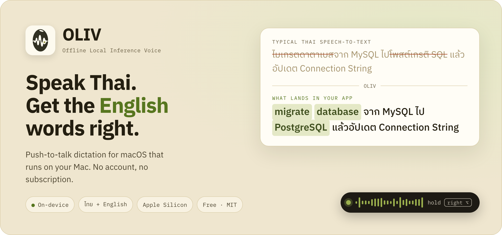
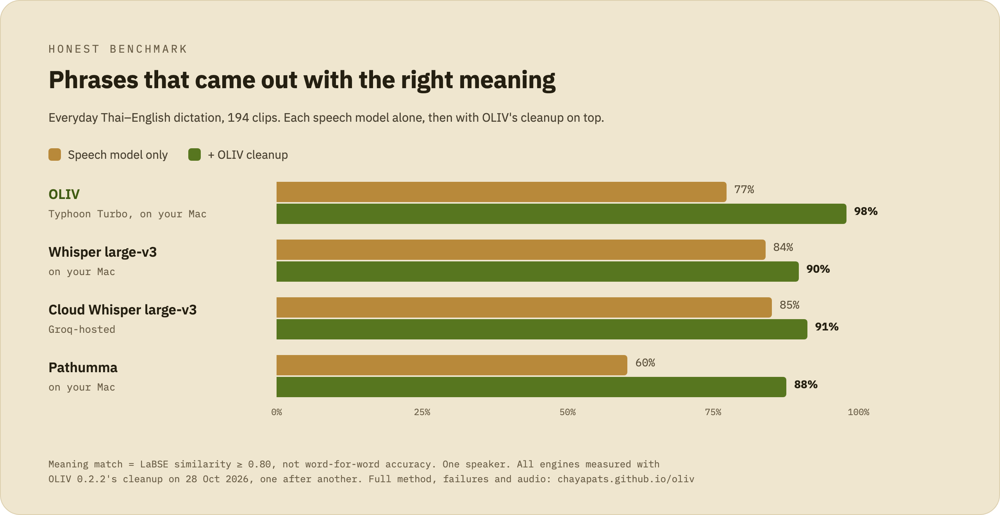
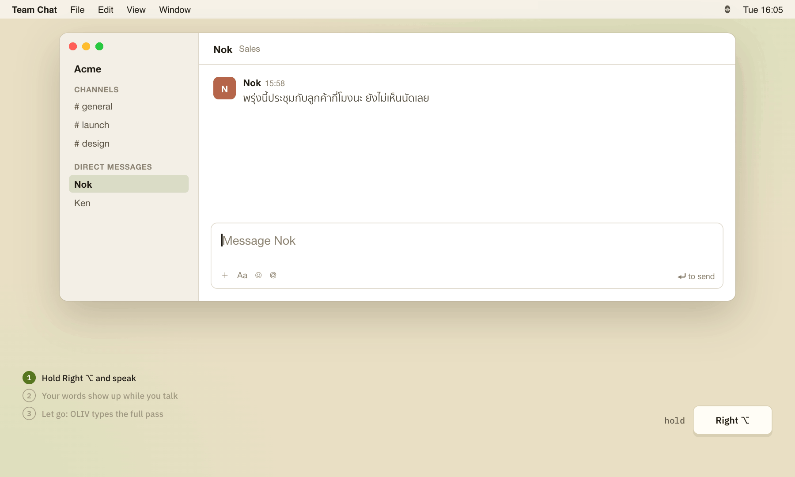
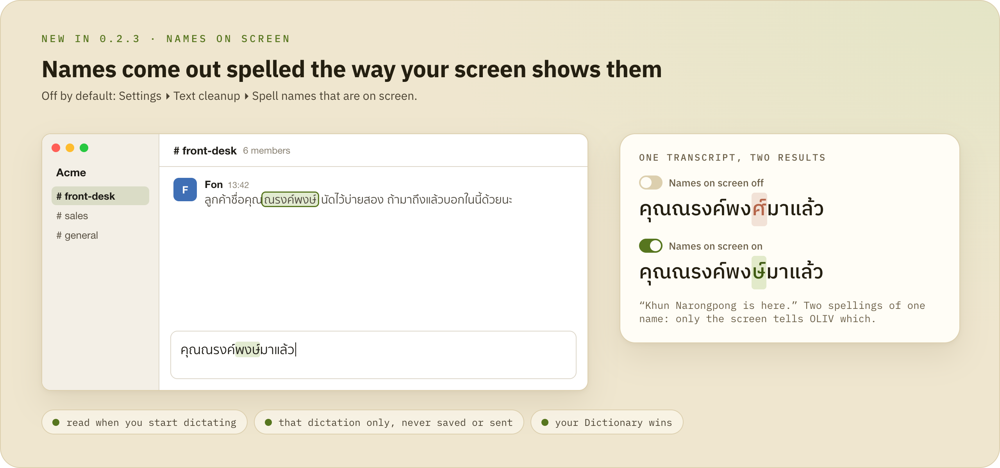
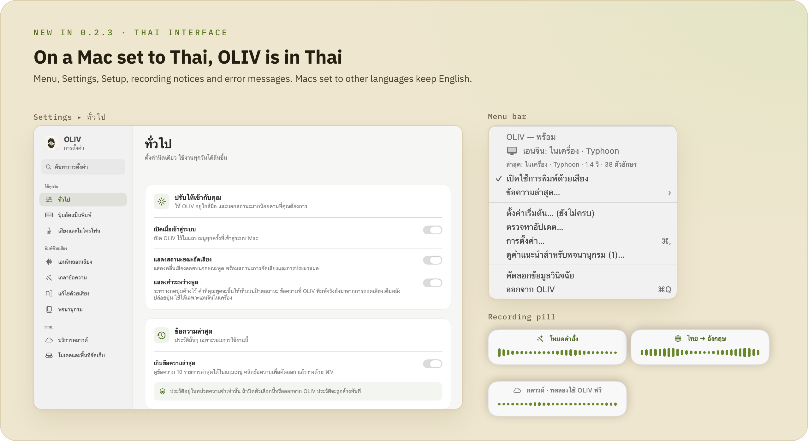
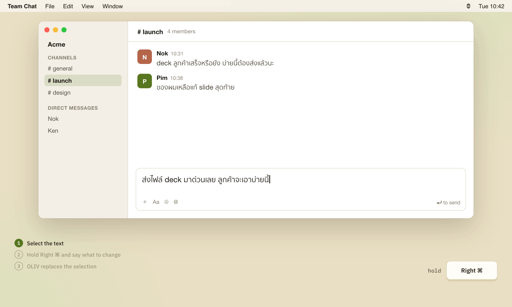
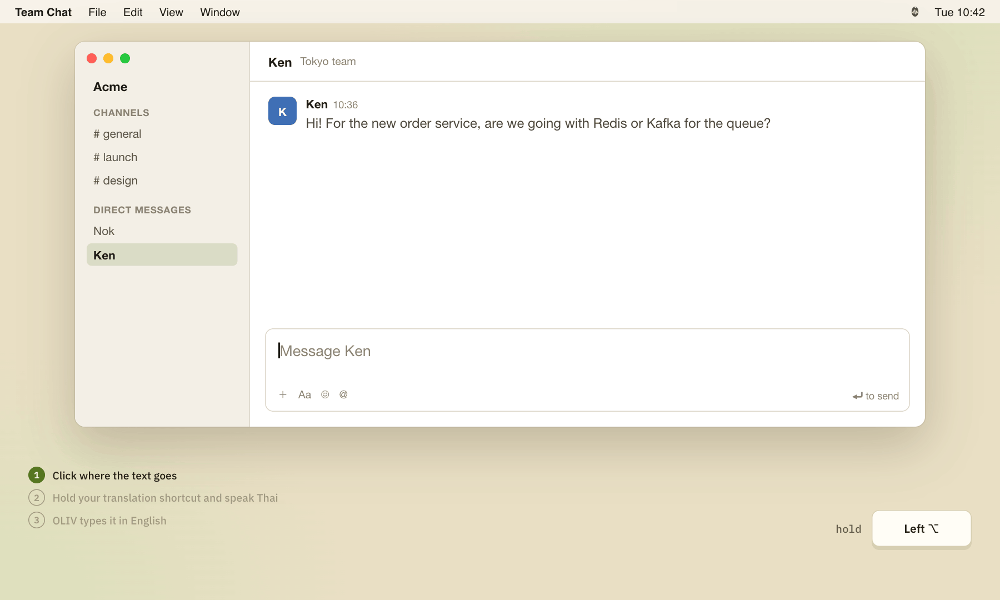
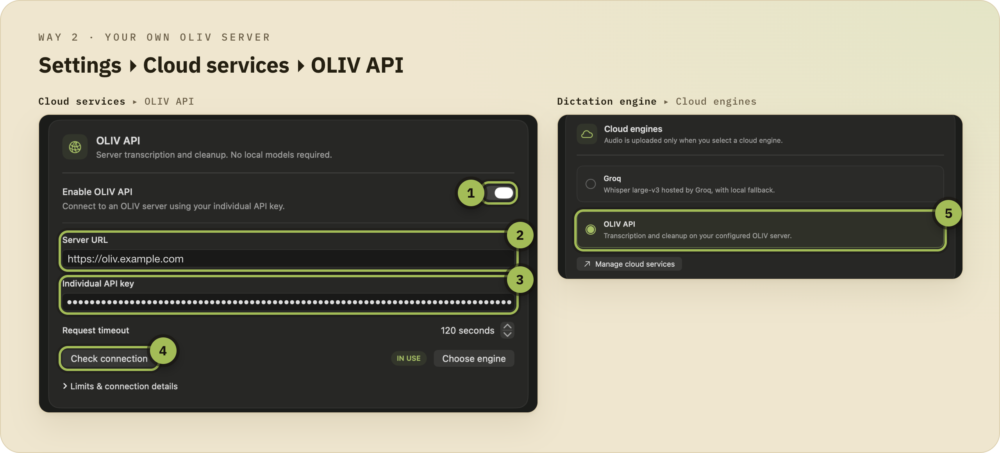
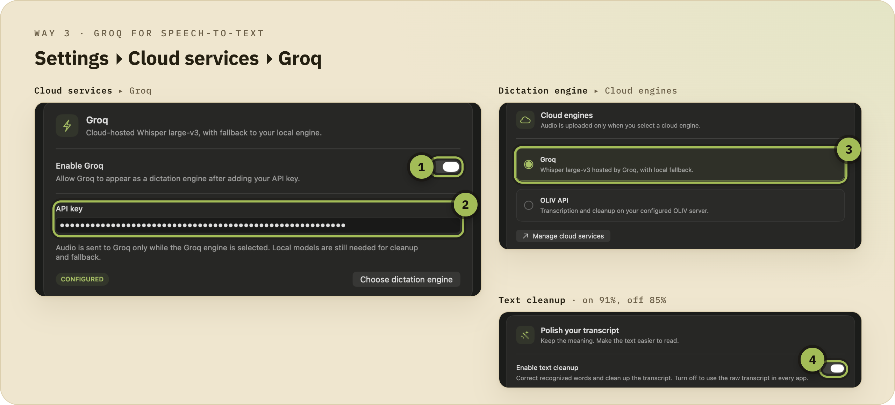

<div align="center">

<picture>
  <source media="(prefers-color-scheme: dark)" srcset="docs/img/readme/hero-dark.png">
  
</picture>

# OLIV: Thai speech-to-text and voice typing for Mac

**Hold a key, speak Thai mixed with English, and OLIV types it into any app.**<br>
On-device dictation for Apple Silicon Macs. Free, open source, no account.

[](https://github.com/chayapats/oliv/releases/latest) [](#install) [](LICENSE) [](https://github.com/chayapats/oliv/releases) [](https://www.greptile.com/?utm_source=oss_badge&utm_medium=readme&utm_campaign=greptile_for_open_source)

<a href="https://github.com/chayapats/oliv/releases/latest/download/OLIV.dmg"></a>

[**ภาษาไทย**](README.th.md) · [Benchmark](https://chayapats.github.io/oliv/) · [OLIV vs Wispr Flow](https://chayapats.github.io/oliv/oliv-vs-wispr.html) · [Changelog](CHANGELOG.md)

</div>

<br>

<picture>
  <source media="(prefers-color-scheme: dark)" srcset="docs/img/readme/demo.gif">
  
</picture>

## The problem

Thai speakers who work in tech mix languages all the time: *"ตัว build fail เพราะ dependency version ไม่ตรง"*. Most Thai speech-to-text spells the English words out in Thai script:

```text
ตัวบิวท์เฟลล์เพราะดิเพนเดนซี่เวอร์ชั่นไม่ตรง
```

Then you fix every word by hand. OLIV turns those words back into English, leaves your Thai alone, and pastes the result at your cursor. By default, speech recognition and cleanup run on your Mac.

## Highlights

- 🇹🇭 **Built for Thai + English.** [Typhoon Whisper Turbo](https://huggingface.co/typhoon-ai/typhoon-whisper-turbo), a Thai fine-tune of Whisper, plus a cleanup step that restores English tech words.
- 🔒 **Local by default.** After a one-time model download, dictation works offline and your audio stays on your Mac.
- ⚡ **About a second.** Median 1.0 s from releasing the key to text, measured on an M4 Pro.
- ⌨️ **Works in any app.** Slack, VS Code, Terminal with Claude Code, Notes, a browser: OLIV pastes wherever your cursor is.
- ✍️ **Edit by voice.** Select text and say "ทำให้สุภาพขึ้น", or speak Thai and get English. Both run on your Mac. *(new in 0.2.3)*
- 👀 **See your words as you speak.** The pill shows what OLIV has heard while you hold the key, so you know early if it misheard. *(new in 0.2.3)*
- 📖 **Learns your words.** Names and jargon in your Dictionary come out spelled your way. Turn on *Names on screen* and so do the names in the window you're typing into. *(new in 0.2.3)*
- 🌏 **Thai interface.** On a Mac set to Thai, OLIV's menus, Settings and notices are in Thai. *(new in 0.2.3)*
- 🆓 **Free and MIT-licensed.** No subscription, no account, no telemetry.

## What's new in 0.2.3

- **[Voice editing](#voice-editing).** *Command mode* rewrites the text you select from a spoken instruction. *Speak Thai, type English* translates your dictation. Both are off by default.
- **[See your words as you speak](#see-your-words-as-you-speak).** While you hold the key, the pill shows what OLIV has heard so far. On by default with on-device engines; the text OLIV types still comes from the full pass after you let go.
- **[Names on screen](#names-on-screen).** Optional: OLIV reads the window you're dictating into and spells the names it shows, for that one dictation. That text never leaves your Mac.
- **[Dictate while the models download](#first-run-download-or-free-trial).** An opt-in free trial through the OLIV server while the 5 GB download runs. It ends by itself.
- **[Report a wrong result](#recent-dictations-and-wrong-result-reports).** Preview a report, edit it, then open it as a GitHub issue. OLIV sends nothing itself.
- **[Thai interface](#thai-interface)** on Macs set to Thai.
- **Cleanup leaves your Thai alone.** It no longer rewrites a misheard name into unrelated Thai words, changes a number, or puts Korean, Lao or Russian letters into your text. The OLIV server gets the same guards once it's updated.
- **Volume comes back** when headphones connect or drop out while you dictate.

Every release is in the [changelog](CHANGELOG.md).

## How it works

<picture>
  <source media="(prefers-color-scheme: dark)" srcset="docs/img/readme/pipeline-dark.png">
  
</picture>

1. **Speak.** Hold the push-to-talk key (Right ⌥ by default). A small pill shows that OLIV is listening, which engine it's using and, with on-device engines, the words it has heard so far.
2. **Transcribe.** Typhoon Whisper Turbo runs on the GPU with [MLX](https://github.com/ml-explore/mlx).
3. **Fix known words.** A Rust core applies a built-in dictionary, sound-alike matching, number and `ๆ` formatting, and your Dictionary. With Names on screen on, names from the window you're typing into count too, ranked below your Dictionary.
4. **Restore English.** A small on-device language model, [Gemma E2B](https://huggingface.co/mlx-community/gemma-4-e2b-it-4bit), turns Thai-spelled jargon back into English. Guards put back Thai the model rewrote, such as a changed number or a Thai name spelled in English.
5. **Paste.** The text appears at your cursor. In apps you mark as verbatim, OLIV pastes the raw transcript.

## How accurate is it?

<picture>
  <source media="(prefers-color-scheme: dark)" srcset="docs/img/readme/chart-dark.png">
  
</picture>

Measured on OLIV 0.2.2 on 28 October 2026 (M4 Pro), with every engine run one after another:

| Test set | Meaning match | Without cleanup | Clips |
|---|---:|---:|---:|
| Everyday speech (tuning set) | 98% | 77% | 194 |
| **Held out** (new jargon, never used for tuning) | **95%** | 60% | 40 |
| Confirmation | 97% | – | 30 |

- **Cleanup is what makes the difference.** On the held-out set, accuracy is 60% without it.
- **OLIV's speech model alone is not the strongest.** Whisper large-v3 transcribes better before cleanup. OLIV leads on the full pipeline while staying on the Mac.
- **0.2.3's cleanup guards don't move these numbers.** Replaying the same transcripts, all three sets score the same ([details](https://github.com/chayapats/oliv/pull/39)).
- **Names on a public benchmark.** On [Thai ContextASR Bench](https://huggingface.co/datasets/wayu-ai/thai-contextasr-bench) (2,062 utterances, many voices), OLIV recognizes 63% of the names and terms on a supplied list, up from 46% before 0.2.2 ([method](benchmark/contextasr.md)).
- **Other voices.** On FLEURS Thai (237 recordings of 80 sentences, read by several people), 95.4% kept their meaning with 0.2.2's cleanup and 96.2% with 0.2.3's guards, replayed on the same transcripts. The exact wording varies with the voice ([details](benchmark/speakers.md)).

**Limits.** "Meaning match" is LaBSE similarity of at least 0.80, not word-for-word accuracy. Every clip in the private sets above was recorded by one speaker, the developer, on one Mac. Recordings by other people on their own Macs and in noisy rooms are still to come ([#18](https://github.com/chayapats/oliv/issues/18)). Names and numbers can be wrong even when the meaning counts as a match, so check before you send.

The [interactive benchmark](https://chayapats.github.io/oliv/) has failures, playable audio and the full method.

## On the Mac

| Feature | What it does |
|---|---|
| **Push-to-talk** | A primary and an optional secondary shortcut: presets or any key you record. A separate shortcut (Control-Shift-Z by default) undoes the last paste. |
| **Speech engines** | Typhoon Whisper Turbo (default, Thai + English), Pathumma, or Whisper large-v3 for mostly-English dictation. Each downloads in Settings with a progress bar. |
| **Text cleanup** | Restores English words, removes fillers (อืม, เอ่อ, um), and formats Thai: `สี่สิบห้า` → `45`, `สองจุดสี่จุดหนึ่ง` → `2.4.1`, `มากมาก` → `มากๆ`. Spoken commands such as "ขึ้นบรรทัดใหม่" or "new paragraph" are off by default. |
| **Dictionary** | Your names, acronyms and jargon guide recognition. Add a correction to turn what you say into exact text ("อีเมลของผม" → `me@example.com`). Thai entries also fix near-miss spellings (บางแคร์ → บางแค). Star, search, switch entries on and off, and import or export CSV. With the OLIV API it syncs to your other devices. |
| **Live preview** | [Your words in the pill while you hold the key](#see-your-words-as-you-speak). On by default, on-device engines only. |
| **Names on screen** | [Spell the names shown in the window you're dictating into](#names-on-screen). Off by default. |
| **Voice editing** | [Command mode and Speak Thai, type English](#voice-editing). Off by default. |
| **Verbatim apps** | Paste the raw transcript, without cleanup, in apps you choose. |
| **Audio** | Pick any microphone, cancel speaker echo so music doesn't turn into text, and lower other audio while you talk. Both are on by default. |
| **Recent dictations** | Your last 10 results in the menu, kept in memory only. Click one to copy it again, or [report one that came out wrong](#recent-dictations-and-wrong-result-reports). |
| **Cloud engines** | Groq or an OLIV server, both off until you add a key and select one. Keys are stored in the macOS Keychain. |
| **Updates** | Signed and notarized builds, updated through Sparkle. |

All settings live in the menu bar: click the OLIV icon, then **Settings…**.

### See your words as you speak

<picture>
  <source media="(prefers-color-scheme: dark)" srcset="docs/img/readme/live-preview-dark.gif">
  
</picture>

While you hold the key, the pill grows and shows the newest words OLIV has heard, so you know early if it misheard. A preview is a quick on-device guess: speech-to-text only, without cleanup or your Dictionary, so English words can still show in Thai script. When you let go, the full pass runs as before, and only its result is pasted. Previews are never pasted, saved or logged.

- On by default. Turn it off with **Settings ▸ General ▸ Show words as you speak** (it needs **Show recording indicator**).
- On-device engines only. With Groq, the OLIV API or the free trial, nothing is previewed and no extra audio is sent.
- One preview at a time, at most about once a second, spaced so previews keep the GPU busy no more than 30% of the time. If they can't keep up on your Mac, OLIV turns them off until it restarts.
- **Speed.** Measured on a busy M4 Pro (other jobs running, load 4 to 112), in paired runs against a control with previews off in both arms: with previews forced on for every hold, text after release came no later (paired median −54 ms; control +1 ms). A release that caught a preview mid-way waited a median 22 ms for it to stop, 287 ms at worst. Final text was byte-identical with previews on and off in all 391 clip pairs. Not yet measured on a quiet Mac or an M1 ([details](https://github.com/chayapats/oliv/pull/44)).

The text in the GIF is what OLIV returned for public benchmark clip mx08: each preview, at the pace the app runs them, then the final pass.

### Names on screen

<picture>
  <source media="(prefers-color-scheme: dark)" srcset="docs/img/readme/names-on-screen-dark.png">
  
</picture>

Optional and off by default: turn on **Settings ▸ Text cleanup ▸ Spell names that are on screen**. When you start dictating, OLIV reads the window you're typing into through Accessibility, picks out up to 50 likely names and terms, and uses them for that one dictation. A coworker's name in a chat or a customer's in an email comes out spelled the way it's shown, without adding it to your Dictionary.

- Your Dictionary always wins, and a name from the screen has to sound closer than a Dictionary word before it replaces anything.
- The text stays in memory on your Mac for that dictation. It is never saved, logged or sent, not even with Groq, which still gets only your audio.
- It skips password fields, password managers and verbatim apps, and doesn't run while secure input is on. It isn't used for Command mode, nor with the OLIV API engine or the free trial, whose cleanup runs on the server. It needs Text cleanup on.
- Electron apps such as Slack's desktop app, Discord and VS Code show little of their text to Accessibility unless an app switches on their accessibility mode (`AXManualAccessibility`). OLIV doesn't, so it sees little there. Native apps such as Mail, Messages, Notes and TextEdit, and web pages in Safari, work. Chrome hasn't been tested.
- On [Thai ContextASR Bench](benchmark/contextasr.md#names-on-screen-2026-11), with each utterance's list of names shown as the window's text, OLIV recognized 57% of the listed names, against 43% with no list. With a window of only unrelated names, 1 of 2,062 utterances came out worse.

The example in the picture is from OLIV's tests: one transcript, with and without ณรงค์พงษ์ on screen.

### Recent dictations and wrong-result reports

<picture>
  <source media="(prefers-color-scheme: dark)" srcset="docs/img/readme/report-wrong-result-dark.png">
  
</picture>

OLIV has no telemetry, so a wrong result you don't report is one nobody hears about. Choose **Recent… ▸ Report a Wrong Result** and pick the result. A preview shows exactly what the report holds; edit it, add what you meant, then **Open in Browser** to get a prefilled GitHub issue. The example above is a real miss from the public benchmark clips.

### Thai interface

<picture>
  <source media="(prefers-color-scheme: dark)" srcset="docs/img/readme/thai-interface-dark.png">
  
</picture>

On a Mac set to Thai, the menu, Settings, Setup, recording notices and error messages are in Thai, with the same words as the iPhone app. Macs set to any other language get English. Diagnostics and wrong-result reports stay in English so they read the same from every Mac.

## Voice editing

New in 0.2.3 and off by default: turn it on in **Settings ▸ Voice editing**. Both modes run on your Mac with the cleanup model, Gemma E2B: the rewrite and the translation happen on the Mac, and selected text is never uploaded. With a cloud engine selected, the cloud transcribes what you say and the edit still runs on the Mac, so the cleanup model must be downloaded.

### Command mode: edit selected text by voice

<picture>
  <source media="(prefers-color-scheme: dark)" srcset="docs/img/readme/command-mode-dark.gif">
  
</picture>

Select text in any app, hold the Command mode shortcut (Right ⌘ by default) and say what to change: "ทำให้สุภาพขึ้น", "สั้นลง", "สรุปเป็น bullet", "แก้คำผิด", "เขียนเป็นอีเมล", "ทางการขึ้น". OLIV replaces the selection, and the undo shortcut puts the original back.

- With nothing selected, it edits the text OLIV just pasted, in apps that let OLIV read it.
- If a guardrail rejects the edit (a term that went missing, a number that changed, lost its minus sign or appeared from nowhere, an answer instead of an edit, the wrong language), your text stays as it was.
- OLIV edits the selection you had when you let go of the key. If you switch apps or change the selection right after, your text is left alone; if you do it while OLIV is writing the edit, the edit goes to the clipboard instead.
- It never reads password fields and never runs in verbatim apps or password managers.

### Speak Thai, type English

<picture>
  <source media="(prefers-color-scheme: dark)" srcset="docs/img/readme/thai-to-english-dark.gif">
  
</picture>

Turn on **Secondary shortcut types English**, or add apps under **Always translate in these apps**. Speak Thai with your usual English mixed in, and OLIV pastes natural English. Names, product names and code terms stay as they are, and your Dictionary still applies. If OLIV isn't confident in a translation, it pastes what you said instead.

### How well it works

Measured on 3 November 2026 with Gemma E2B on an M4 Pro, on 77 invented public cases ([method and cases](benchmark/voice-edit.md)):

| | Command mode | Speak Thai, type English |
|---|---:|---:|
| Follows the instruction | 78% (31 of 40) | 100% (37 of 37) |
| Terms, names and numbers kept (applied edits) | 100% | 96% |
| Tricky cases handled (questions, "ignore previous instructions", empty or too-long input) | 8 of 8 | 5 of 5 |
| Median time for the edit, typical text, quiet machine | 0.9 s | 0.6 s |

Add about a second to transcribe what you say. "Shorter" often trims only a little, and nothing checks Thai names yet: one translation dropped a name. The text in both demos above is the recorded output for benchmark cases c01 and t16.

## First run: download or free trial

<picture>
  <source media="(prefers-color-scheme: dark)" srcset="docs/img/readme/first-run-dark.png">
  
</picture>

OLIV needs about 5 GB of models before it can dictate on your Mac. You have two choices in Setup:

- **Wait for the download** (the default). Nothing leaves your Mac.
- **Try it now through the OLIV server.** Until the download finishes, your recordings go to the OLIV server for transcription and cleanup. The pill, the menu and Settings show **Cloud · OLIV free trial** the whole time. Your Dictionary is never sent. When the models are ready, OLIV switches back to your Mac, tells you, and deletes the trial key. If the download stops, the trial stops too.

The trial is a short-lived key with a small daily limit. It is off unless you press the button, and only builds that come with a server, such as the DMG, offer it. Builds from source don't.

## iPhone app and keyboard

[`ios/`](ios/README.md) is a native iPhone client for an OLIV server: speak Thai and English, get the same cleanup, and use the text where you're writing.

- **Start with one press.** Put **Toggle OLIV** on the Action button or in Control Center. OLIV records, finishes after a 1.5-second pause by default, and shows a Live Activity you can stop from the Lock Screen or Dynamic Island.
- **OLIV keyboard (optional).** An English/Thai keyboard that inserts the new result into the field you were typing in, if that field hasn't changed. Or keep Apple's keyboard and paste.
- **Dictionary sync.** The same Dictionary as your Mac and other devices, through your OLIV server.
- **Free trial or your own server.** Setup can start a free trial on the OLIV server, or you can connect your own server with an API key.
- **Report a wrong result** from any result or from History, with the same preview-first flow as the Mac.

**Status: public beta on TestFlight.** [Join the beta](https://testflight.apple.com/join/SSYXfbej) on iOS 18 or later. The current TestFlight listing asks for an API key from an OLIV server's operator. The setup free trial and Report a wrong result are on `main` and reach testers with the next build that passes Apple's beta review.

## Ways to run OLIV

<picture>
  <source media="(prefers-color-scheme: dark)" srcset="docs/img/readme/ways-to-run-dark.png">
  
</picture>

| | Your audio goes to | Model download on the Mac | Meaning match |
|---|---|---|---:|
| **On your Mac** (default) | Nowhere | About 5 GB, once | 98% |
| **Free trial** (only while the models download) | The OLIV server | Runs in the background | – |
| **Your own OLIV server** | Your server | None | – |
| **Groq** | Groq | About 3.3 GB for cleanup, or none | 91% with cleanup, 85% without |

Meaning match is on the 194 everyday clips. The OLIV server runs the same two models, converted for NVIDIA GPUs; its accuracy isn't published here.

### On your Mac (default)

Nothing to set up: Typhoon Whisper Turbo is selected and **Settings ▸ Dictation engine** says **Audio stays on this Mac.** Keep **Text cleanup** on for the full accuracy.

### Your own OLIV server

For developers and teams. Run speech-to-text and cleanup on a Linux machine with an NVIDIA GPU, then point your Mac, Linux, Windows and iPhone clients at it. Set up the server with [server/README.md](server/README.md) and create a key for each device with `oliv-keys`. Then, on the Mac:

<picture>
  <source media="(prefers-color-scheme: dark)" srcset="docs/img/readme/setup-server-dark.png">
  
</picture>

1. In **Cloud services**, turn on **Enable OLIV API**.
2. Enter your **Server URL**, the base URL only (for example `https://oliv.example.com`).
3. Paste this device's **Individual API key**. It's stored in the macOS Keychain.
4. Click **Check connection**.
5. In **Dictation engine**, choose **OLIV API**.

The Mac downloads no speech models in this mode (voice editing still needs the cleanup model). Your Dictionary syncs across the devices whose keys you link with `oliv-keys profile link` ([server/docs/DICTIONARY.md](server/docs/DICTIONARY.md)). On Linux and Windows, use the [desktop client](desktop/README.md).

### Groq for speech-to-text

Groq runs Whisper large-v3 in the cloud. OLIV can still clean up the text on your Mac.

<picture>
  <source media="(prefers-color-scheme: dark)" srcset="docs/img/readme/setup-groq-dark.png">
  
</picture>

1. Create an API key at [console.groq.com](https://console.groq.com/keys). In **Cloud services**, turn on **Enable Groq**.
2. Paste the key. It's stored in the macOS Keychain.
3. In **Dictation engine**, choose **Groq**.
4. In **Text cleanup**, choose how much OLIV does after Groq:
   - **On (91%):** Gemma runs on your Mac (about 3.3 GB download), restores English words, formats Thai numbers and applies your whole Dictionary.
   - **Off (85%):** no model to download. Only Dictionary entries with a correction are applied; plain Dictionary words are sent to Groq as recognition hints.

If Groq fails, OLIV retries once on Typhoon Whisper Turbo, but only if that model is downloaded.

## Install

1. **[Download OLIV.dmg](https://github.com/chayapats/oliv/releases/latest/download/OLIV.dmg)** (about 27 MB, signed and notarized by Apple).
2. Open it and drag **OLIV** into **Applications**.
3. Launch OLIV and allow **Microphone** and **Accessibility**. Accessibility lets OLIV paste into other apps.
4. Setup downloads the models from Hugging Face, about **5 GB** once. To dictate before it finishes, see the [free trial](#first-run-download-or-free-trial).
   - Speech: [`chayapats/typhoon-whisper-turbo-mlx`](https://huggingface.co/chayapats/typhoon-whisper-turbo-mlx), about 1.5 GB (an MLX conversion of SCB 10X's Typhoon)
   - Cleanup: [`mlx-community/gemma-4-e2b-it-4bit`](https://huggingface.co/mlx-community/gemma-4-e2b-it-4bit), about 3.3 GB
5. Hold **Right ⌥ Option**, speak, and let go.

**Requirements:** an Apple Silicon Mac (M1 or newer) with macOS 14 Sonoma or later.

## Privacy

What leaves your Mac depends on the engine you choose:

| Mode | What leaves your Mac | Where it goes |
|---|---|---|
| **On-device engines** (default) | No audio and no text | – |
| **Free trial** (opt-in, while the models download) | Your recordings | The OLIV server run by the developer, through its tunnel provider. Your Dictionary is never sent. |
| **OLIV API** | Your recordings and your Dictionary | Your server, and whatever terminates TLS in front of it |
| **Groq** | Your recordings and your Dictionary words, as recognition hints | Groq |
| **Voice editing** | Nothing: selected text is edited and translated on the Mac | – |
| **Live preview** | Nothing: previews run only with on-device engines | – |
| **Names on screen** (opt-in) | Nothing: the window's text is read on the Mac for one dictation, then dropped | – |

- Cloud engines are off until you add a key and select one. The free trial is the one exception you can opt into in Setup; it's labelled Cloud and ends by itself.
- The OLIV server keeps audio and text in memory only. Its usage log records key, route, status and timings ([server privacy](server/README.md#data-and-privacy)).
- Recent dictations are kept in memory and cleared when you quit.
- **Report a Wrong Result** opens a preview you can edit, then a prefilled **public** GitHub issue in your browser. It holds what OLIV typed, the raw transcript, what you meant (if you add it), the engine, the cleanup steps, the app and macOS version, and timing. A report about a Command mode edit or a translation also holds the text you selected (or the Thai that was translated) and what you asked for. It never includes audio, your server address, API keys or your Dictionary. OLIV sends nothing itself: the issue exists only if you submit it.
- **Copy Diagnostics** creates a plain-text support report without transcripts or API keys.
- No analytics and no telemetry. The network is used for the model download, update checks, and any cloud engine or trial you choose.

## Linux and Windows

The [OLIV desktop client](desktop/README.md) runs on Linux (Hyprland/Wayland) and Windows 10/11. Hold Right Shift, speak, let go. It has no models of its own: it needs an [OLIV server](server/README.md) you run on a GPU machine, or a key from someone who runs one.

## FAQ

<details>
<summary><b>Is OLIV a free alternative to Wispr Flow or Superwhisper for Thai?</b></summary>

Yes. It's free, open source and focused on Thai mixed with English. On our 264-clip Thai–English set, OLIV led [Wispr Flow](https://chayapats.github.io/oliv/oliv-vs-wispr.html) on overall meaning match (97% vs 93%) and returned text slightly sooner after the key was released (median 1.0 s vs 1.4 s). Wispr was ahead on dense jargon (100% vs 98%). One speaker, tested once, on 28 October 2026.
</details>

<details>
<summary><b>Does it work offline?</b></summary>

Yes. After the one-time model download, dictation and voice editing need no internet connection.
</details>

<details>
<summary><b>Can I dictate only English, or only Thai?</b></summary>

Yes. Typhoon Whisper Turbo handles Thai, English and mixed speech. For mostly-English dictation, switch to Whisper large-v3 in Settings.
</details>

<details>
<summary><b>Why does OLIV need Accessibility permission?</b></summary>

To paste into the app you're using. In Command mode it also reads the text you selected, only while you use the Command mode shortcut, and never from a password field. If you turn on Names on screen, it reads the window you're dictating into when you start, never a password field or a password manager.
</details>

<details>
<summary><b>Does it work on Intel Macs?</b></summary>

No. The Mac app runs its models with Apple's MLX, which needs Apple Silicon.
</details>

## Build from source

Requires an Apple Silicon Mac with macOS 14+, Xcode, [Rust](https://rustup.rs) and XcodeGen. Python is not needed.

```bash
brew install xcodegen ripgrep
xcodebuild -downloadComponent MetalToolchain
bash scripts/build_app.sh   # → build/OLIV.app
bash scripts/test.sh        # Rust, native runtime and Swift tests
```

Source builds have no default server, so they don't offer the free trial.

| Path | What it is |
|---|---|
| `macos/` | The Mac app: Swift UI and on-device MLX inference |
| `rust/` | Shared crates, including `oliv-text-core`, the text pipeline the Mac app and the server share |
| `server/` | Self-hostable OLIV server for your own GPU machine ([server/README.md](server/README.md)) |
| `desktop/` | Linux and Windows client for an OLIV server ([desktop/README.md](desktop/README.md)) |
| `ios/` | iPhone app and OLIV keyboard, in TestFlight beta ([ios/README.md](ios/README.md)) |
| `benchmark/` | Evaluation tools and published results ([benchmark/README.md](benchmark/README.md)) |

## Contributing

Issues and pull requests are welcome, in Thai or English. Please read [CONTRIBUTING.md](CONTRIBUTING.md) and the [Code of Conduct](CODE_OF_CONDUCT.md). Report security issues privately as described in [SECURITY.md](SECURITY.md). To measure OLIV on your own recordings, see [benchmark/README.md](benchmark/README.md).

If OLIV saves you time, a ⭐ helps other Thai speakers find it.

## Credits and license

- **Code:** [MIT](LICENSE) © 2026 Chayapat Sriwattanachote.
- **Speech model:** Typhoon Whisper Turbo by [SCB 10X](https://huggingface.co/typhoon-ai/typhoon-whisper-turbo) (MIT), based on OpenAI Whisper. OLIV ships [an MLX conversion](https://huggingface.co/chayapats/typhoon-whisper-turbo-mlx); credit for the model goes to the original authors.
- **Cleanup model:** Gemma, under its own upstream license.
- **Libraries:** [MLX Swift](https://github.com/ml-explore/mlx-swift), [Sparkle](https://sparkle-project.org) and the Rust crates in `rust/Cargo.lock`. Their licenses ship inside the app.

Third-party names such as Groq, Whisper and Wispr Flow belong to their owners. Comparisons use our own Thai–English dictation set and were run once.
