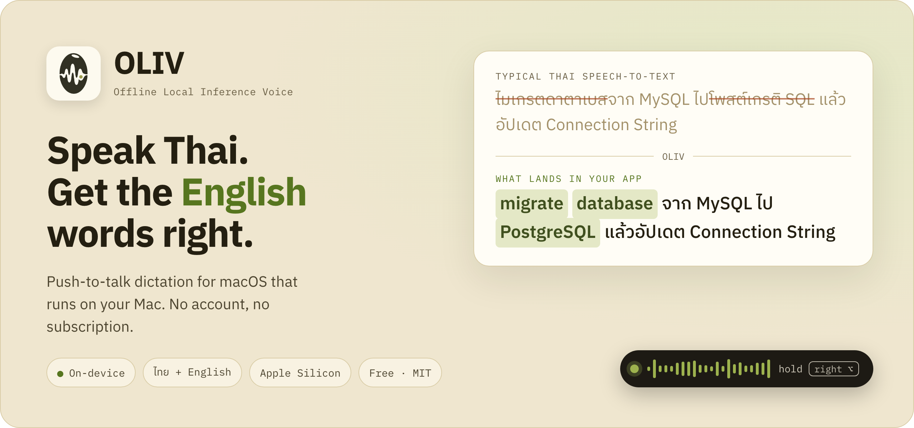
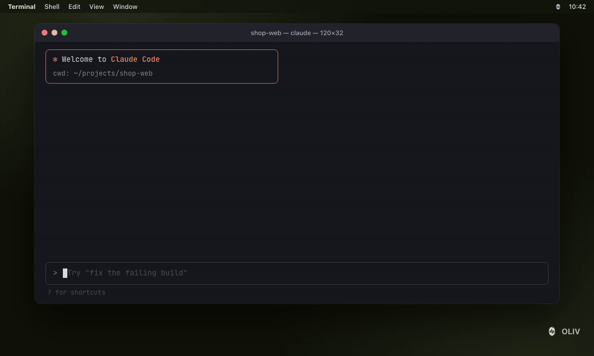
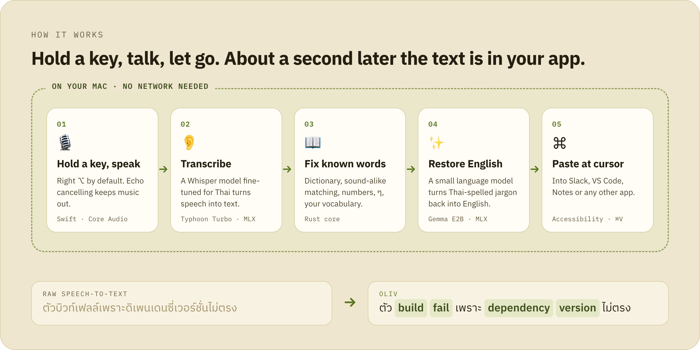
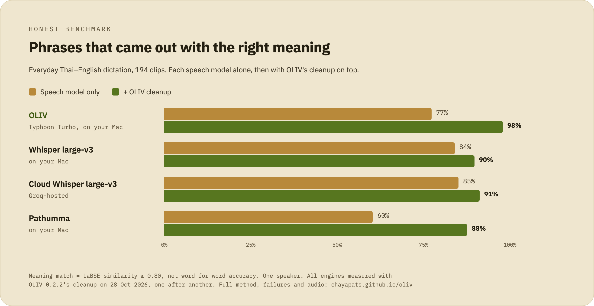
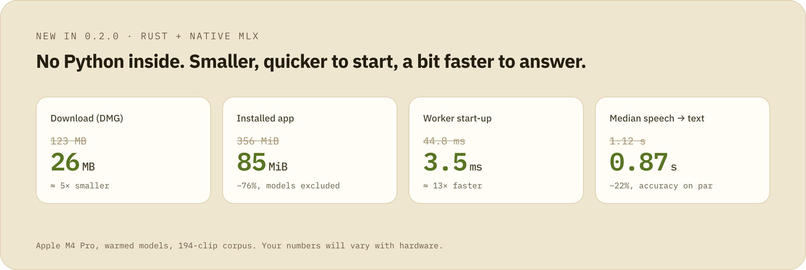
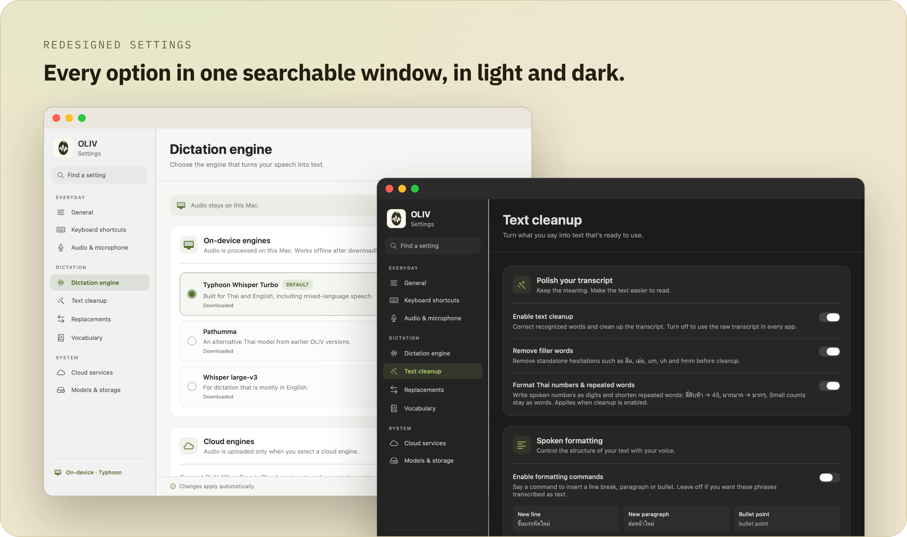
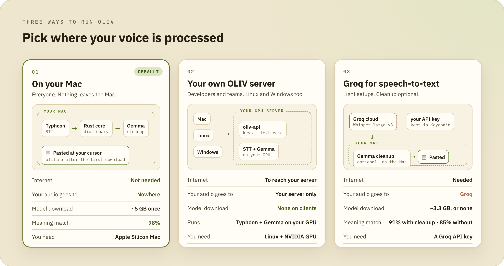
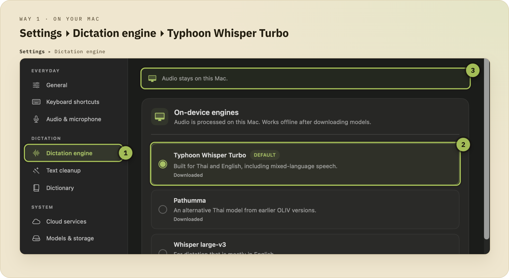
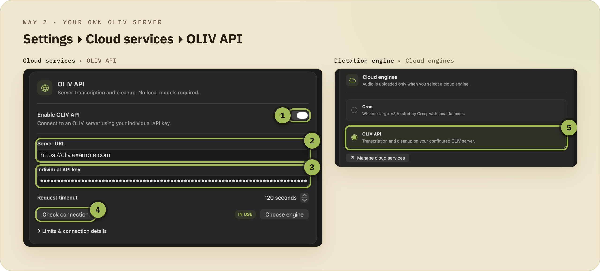
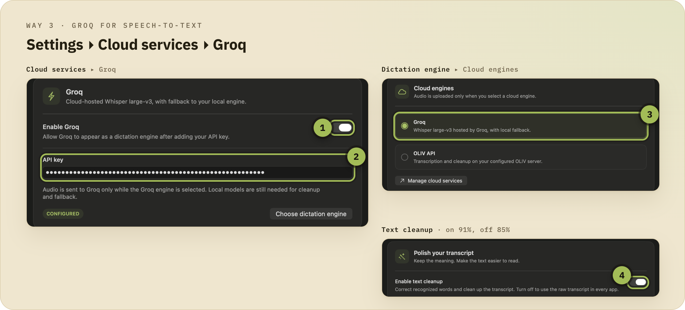

<div align="center">

<picture>
  <source media="(prefers-color-scheme: dark)" srcset="docs/img/readme/hero-dark.png">
  
</picture>

# OLIV: Thai speech-to-text and voice typing for Mac

**Hold a key, speak Thai mixed with English, and OLIV types it into any app.**<br>
Offline dictation for Apple Silicon. Free and open source.

[](https://github.com/chayapats/oliv/releases/latest) [](#install) [](LICENSE) [](https://github.com/chayapats/oliv/releases) [](https://www.greptile.com/?utm_source=oss_badge&utm_medium=readme&utm_campaign=greptile_for_open_source)

<a href="https://github.com/chayapats/oliv/releases/latest/download/OLIV.dmg"></a>

[**ภาษาไทย**](README.th.md) · [Benchmark](https://chayapats.github.io/oliv/) · [OLIV vs Wispr Flow](https://chayapats.github.io/oliv/oliv-vs-wispr.html) · [Changelog](CHANGELOG.md)

</div>

<br>

<p align="center">
  
</p>

## The problem

Thai speakers who work in tech mix languages constantly: *"ตัว build fail เพราะ dependency version ไม่ตรง"*. Most Thai speech-to-text spells those English words out in Thai script, so you get:

```text
ตัวบิวท์เฟลล์เพราะดิเพนเดนซี่เวอร์ชั่นไม่ตรง
```

Then you fix every word by hand. OLIV turns the English words back into English, leaves the Thai alone, and pastes the result at your cursor. Speech recognition and cleanup run locally on your Mac by default.

## Highlights

- 🇹🇭 **Built for Thai + English.** Uses [Typhoon Whisper Turbo](https://huggingface.co/typhoon-ai/typhoon-whisper-turbo), a Thai fine-tune of Whisper, plus a cleanup pass that restores English tech words.
- 🔒 **Local by default.** After a one-time model download, dictation works offline. Your audio stays on your Mac unless you turn on a cloud engine yourself.
- ⚡ **About a second.** Median 1.0 s from releasing the key to text, measured on an M4 Pro.
- ⌨️ **Works in any app.** Slack, VS Code, Terminal with Claude Code, Notes, a browser: OLIV pastes wherever your cursor is.
- 📖 **Learns your words.** Add names and jargon to your Dictionary and OLIV spells them your way, even when the speech model gets a Thai name slightly wrong.
- 🔢 **Formats Thai.** `สี่สิบห้า` becomes `45`, `สองจุดสี่จุดหนึ่ง` becomes `2.4.1`, and `มากมาก` becomes `มากๆ`.
- 🎧 **Ignores your music.** Echo cancellation subtracts what your Mac is playing, so songs don't turn into text.
- 🆓 **Free, MIT-licensed, no account.** No subscription and no telemetry.

## How it works

<picture>
  <source media="(prefers-color-scheme: dark)" srcset="docs/img/readme/pipeline-dark.png">
  
</picture>

1. **Speak.** Hold the push-to-talk key (Right ⌥ by default). A small waveform pill shows that OLIV is listening.
2. **Transcribe.** Typhoon Whisper Turbo runs on the GPU with [MLX](https://github.com/ml-explore/mlx).
3. **Fix known words.** A Rust core applies a built-in dictionary, sound-alike matching, number and `ๆ` formatting, and your personal Dictionary.
4. **Restore English.** A small on-device language model ([Gemma E2B](https://huggingface.co/mlx-community/gemma-4-e2b-it-4bit)) changes Thai-spelled jargon back to English and leaves everything else as you said it.
5. **Paste.** The text appears at your cursor with ⌘V. Per-app verbatim mode skips cleanup for terminals and password managers.

## How accurate is it?

<picture>
  <source media="(prefers-color-scheme: dark)" srcset="docs/img/readme/chart-dark.png">
  
</picture>

| Test set | Meaning match | Clips |
|---|---:|---:|
| **Held out** (new jargon, never used for tuning) | **~95%** | 40 |
| Everyday speech (tuning set) | ~98% | 194 |
| Confirmation | ~97% | 30 |

- **The cleanup step makes the difference.** On the held-out set, accuracy drops to 60% without it.
- **OLIV's raw speech model is not the strongest.** Whisper large-v3 transcribes slightly better before cleanup. OLIV wins on the full pipeline while staying local and about half the size. All results were re-measured on 0.2.2 (28 October 2026).
- **Names are tested on a public benchmark too.** On [Thai ContextASR Bench](https://huggingface.co/datasets/wayu-ai/thai-contextasr-bench) (2,062 utterances from many voices), OLIV 0.2.2 recognizes 63% of the names and terms on a supplied list, up from 46% before. See the [method and results](benchmark/contextasr.md).
- **These numbers have limits.** "Meaning match" is LaBSE semantic similarity of at least 0.80, not word-for-word accuracy. All clips were recorded by one speaker (the developer), so other voices, accents and noisy rooms are untested. Names and numbers can be wrong even when the meaning counts as a match, so check before you send.

The [interactive benchmark](https://chayapats.github.io/oliv/) includes failures, playable audio and the full method.

## What's new

**0.2.2: your Dictionary understands Thai spellings.** Thai names and terms in your Dictionary now fix near-miss spellings (บางแคร์ → บางแค, พงศ์ → พงษ์), and a name you add in English replaces its Thai spelling (คลองเตย → Khlong Toei). Long lists cause fewer wrong substitutions, and dictation with an empty Dictionary is unchanged.

**0.2.1: one Dictionary, synced.** Vocabulary and Replacements are now a single Dictionary with stars, on/off switches, search and CSV import/export. With the OLIV API it syncs across your devices, and OLIV can suggest words you keep correcting. Nothing is added until you approve it.

**0.2.0: native Rust and MLX.**

<picture>
  <source media="(prefers-color-scheme: dark)" srcset="docs/img/readme/native-dark.png">
  
</picture>

OLIV 0.2.0 removed Python from the app. Text processing and API requests use a shared Rust core, and Whisper and Gemma run on native MLX in Swift. Accuracy stayed on par with 0.1.x (mean WER 12.34% vs 12.58% on the main corpus). It also brought a redesigned Settings window, faster push-to-talk start-up and the opt-in OLIV API engine. See the [changelog](CHANGELOG.md) for every release and the [migration notes](docs/native-runtime-migration.md).

## Features

<p align="center">
  
</p>

| Feature | What it does |
|---|---|
| **Push-to-talk** | Primary and optional secondary shortcut, presets or any key you record. A separate shortcut undoes the last paste. |
| **Speech engines** | Typhoon Whisper Turbo (default, Thai + English), Pathumma, or Whisper large-v3 for mostly-English dictation. Each downloads in Settings with a progress bar. |
| **Text cleanup** | Restores English words, removes fillers (อืม, เอ่อ, um), formats numbers and `ๆ`, and supports spoken commands such as "ขึ้นบรรทัดใหม่" or "new paragraph" (off by default). |
| **Dictionary** | Your names, acronyms and jargon guide recognition; add a correction to turn what you say into exact text ("อีเมลของผม" → `me@example.com`). Thai entries also fix near-miss spellings (บางแคร์ → บางแค). Star the words that matter most, import/export CSV, and with the OLIV API it syncs to your other devices. |
| **Verbatim apps** | Paste the raw transcript, without cleanup, in apps you choose. |
| **Audio** | Pick any microphone, cancel speaker echo, and lower other audio while you talk. Bluetooth headphones keep full playback quality. |
| **Recent dictations** | Your last 10 results in the menu, kept in memory only. Click one to copy it again. |
| **Optional cloud engines** | Groq or a self-hosted OLIV API, both off by default. Audio leaves your Mac only while you select one. Keys are stored in the macOS Keychain. |
| **Auto-update** | Signed and notarized builds, with updates delivered through Sparkle. |

## Install

1. **[Download OLIV.dmg](https://github.com/chayapats/oliv/releases/latest/download/OLIV.dmg)** (27 MB, signed and notarized by Apple).
2. Open it and drag **OLIV** into **Applications**.
3. Launch OLIV and allow **Microphone** and **Accessibility** access. Accessibility lets OLIV paste into other apps.
4. On first run, OLIV downloads its models from Hugging Face, about **5 GB** once:
   - Speech: [`chayapats/typhoon-whisper-turbo-mlx`](https://huggingface.co/chayapats/typhoon-whisper-turbo-mlx), about 1.5 GB (an MLX conversion of SCB 10X's Typhoon)
   - Cleanup: [`mlx-community/gemma-4-e2b-it-4bit`](https://huggingface.co/mlx-community/gemma-4-e2b-it-4bit), about 3.3 GB
5. Hold **Right ⌥ Option**, speak, and let go.

**Requirements:** an Apple Silicon Mac (M1 or newer) with macOS 14 Sonoma or later. The OLIV API engine needs an internet connection and an API key instead of local models.

## Three ways to run OLIV

<picture>
  <source media="(prefers-color-scheme: dark)" srcset="docs/img/readme/setup-paths-dark.png">
  
</picture>

All settings live in the menu bar: click the OLIV icon, then **Settings…**.

### 1. On your Mac (default, offline)

<picture>
  <source media="(prefers-color-scheme: dark)" srcset="docs/img/readme/setup-local-dark.png">
  
</picture>

1. Open **Dictation engine**.
2. Keep **Typhoon Whisper Turbo** selected. It's the default, so a fresh install needs no changes.
3. Check that the banner says **Audio stays on this Mac.** Leave **Text cleanup** on for the full 98%.

After the one-time model download (about 5 GB), dictation works without internet and your audio is never uploaded.

### 2. Your own OLIV server

For developers and teams. Run speech-to-text and cleanup on a Linux machine with an NVIDIA GPU, then point your Mac, Linux and Windows computers at it. Set up the server with [server/README.md](server/README.md) and create a key for each device with `oliv-keys`. Then, on the Mac:

<picture>
  <source media="(prefers-color-scheme: dark)" srcset="docs/img/readme/setup-server-dark.png">
  
</picture>

1. In **Cloud services**, turn on **Enable OLIV API**.
2. Enter your **Server URL**, the base URL only (for example `https://oliv.example.com`).
3. Paste this device's **Individual API key**. It's stored in the macOS Keychain.
4. Click **Check connection**.
5. In **Dictation engine**, choose **OLIV API**.

The Mac downloads no models in this mode. Audio goes only to your server and to whatever terminates TLS in front of it, and your Dictionary syncs across the devices whose keys you link with `oliv-keys profile link` (each key has its own Dictionary until linked; see [server/docs/DICTIONARY.md](server/docs/DICTIONARY.md)). On Linux and Windows, use the [OLIV desktop client](desktop/README.md).

### 3. Groq for speech-to-text

Groq runs Whisper large-v3 in the cloud. OLIV can still clean up the text on your Mac.

<picture>
  <source media="(prefers-color-scheme: dark)" srcset="docs/img/readme/setup-groq-dark.png">
  
</picture>

1. Create an API key at [console.groq.com](https://console.groq.com/keys). In **Cloud services**, turn on **Enable Groq**.
2. Paste the key. It's stored in the macOS Keychain.
3. In **Dictation engine**, choose **Groq**.
4. In **Text cleanup**, choose how much OLIV does after Groq:
   - **On (91% meaning match):** Gemma runs on your Mac (about 3.3 GB download), restores English words, formats Thai numbers and applies your whole Dictionary.
   - **Off (85%):** no model to download. Only Dictionary entries with **Correct a misspelling** are applied. Plain Dictionary words are sent to Groq as recognition hints.

Your audio goes to Groq while this engine is selected. If Groq fails, OLIV retries once on Typhoon Whisper Turbo, but only if that model is downloaded.

## Privacy

- With the default on-device engines, audio is processed on your Mac and is never uploaded.
- Cloud engines are off until you enable one, add a key and select it.
- Recent dictations are kept in memory only and are cleared when you quit.
- **Copy Diagnostics** creates a plain-text support report that never includes transcripts or API keys.
- OLIV has no analytics and no telemetry. The network is used for the model download, update checks and any cloud engine you choose.

## FAQ

<details>
<summary><b>Is OLIV a free alternative to Wispr Flow or Superwhisper for Thai?</b></summary>

Yes. It's free, open source and focused on Thai mixed with English. On our 264-clip Thai–English set, OLIV led [Wispr Flow](https://chayapats.github.io/oliv/oliv-vs-wispr.html) on overall meaning match (97% vs 93%) and returned text slightly sooner after the key was released (median 1.0 s vs 1.4 s). Wispr was ahead on heavy jargon (100% vs 98%). One speaker, tested once on 28 October 2026.
</details>

<details>
<summary><b>Does it work offline?</b></summary>

Yes. After the one-time model download, the default engines need no internet connection.
</details>

<details>
<summary><b>Does it work on Intel Macs, Windows or Linux?</b></summary>

The Mac app needs Apple Silicon because it runs models with Apple's MLX. On Windows 10/11 and Linux (Hyprland), use the [OLIV desktop client](desktop/README.md) with an [OLIV server](server/README.md) you run on a GPU machine, or one whose operator gives you a key.
</details>

<details>
<summary><b>Can I dictate only English, or only Thai?</b></summary>

Yes. Typhoon Whisper Turbo handles Thai, English and mixed speech. For mostly-English dictation, switch to Whisper large-v3 in Settings.
</details>

<details>
<summary><b>Why does OLIV need Accessibility permission?</b></summary>

To paste text into the app you're using. OLIV doesn't read your screen.
</details>

## Build from source

Requires an Apple Silicon Mac with macOS 14+, Xcode, [Rust](https://rustup.rs) and XcodeGen. Python is not needed.

```bash
brew install xcodegen ripgrep
xcodebuild -downloadComponent MetalToolchain
bash scripts/build_app.sh   # → build/OLIV.app
bash scripts/test.sh        # Rust, native runtime and Swift tests
```

Repository layout:

| Path | What it is |
|---|---|
| `macos/` | The Mac app: Swift UI and on-device MLX inference |
| `rust/` | Shared crates, including `oliv-text-core`, the text pipeline every OLIV client and the server use |
| `server/` | Self-hostable OLIV server: run STT + cleanup on your own GPU machine and point clients at it ([server/README.md](server/README.md)) |
| `desktop/` | Linux (Hyprland/Wayland) and Windows client for an OLIV server ([desktop/README.md](desktop/README.md)) |
| `benchmark/` | Native evaluation tools |

See [CONTRIBUTING.md](CONTRIBUTING.md) and [benchmark/README.md](benchmark/README.md) to run the benchmark on your own recordings.

## Contributing

Issues and pull requests are welcome, in Thai or English. Please read [CONTRIBUTING.md](CONTRIBUTING.md) and the [Code of Conduct](CODE_OF_CONDUCT.md). Report security issues privately as described in [SECURITY.md](SECURITY.md).

If OLIV saves you time, a ⭐ helps other Thai speakers find it.

## Credits and license

- **Code:** [MIT](LICENSE) © 2026 Chayapat Sriwattanachote.
- **Speech model:** Typhoon Whisper Turbo by [SCB 10X](https://huggingface.co/typhoon-ai/typhoon-whisper-turbo) (MIT), based on OpenAI Whisper. OLIV ships [an MLX conversion](https://huggingface.co/chayapats/typhoon-whisper-turbo-mlx); credit for the model goes to the original authors.
- **Cleanup model:** Gemma, under its own upstream license.
- **Libraries:** [MLX Swift](https://github.com/ml-explore/mlx-swift), [Sparkle](https://sparkle-project.org) and the Rust crates listed in `rust/Cargo.lock`. Their licenses ship inside the app.

Third-party names such as Groq, Whisper and Wispr Flow belong to their owners. Comparisons use our own Thai–English dictation set and were run once.
