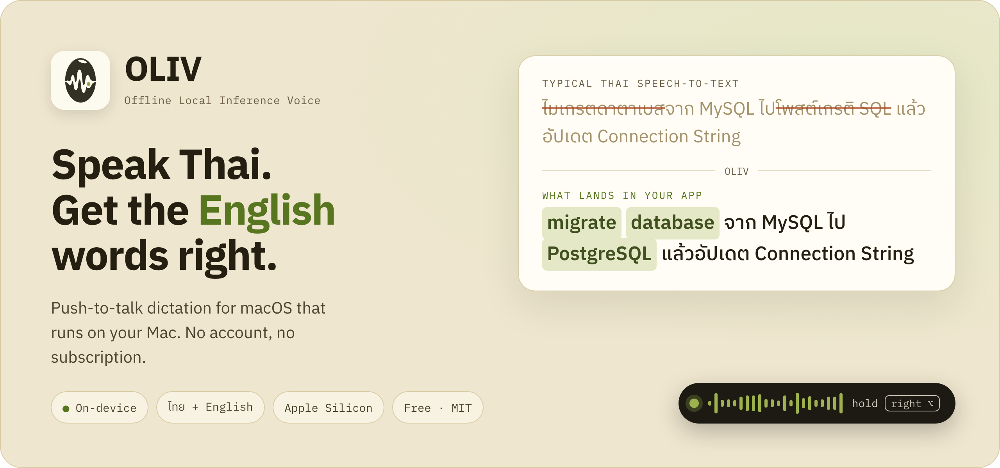
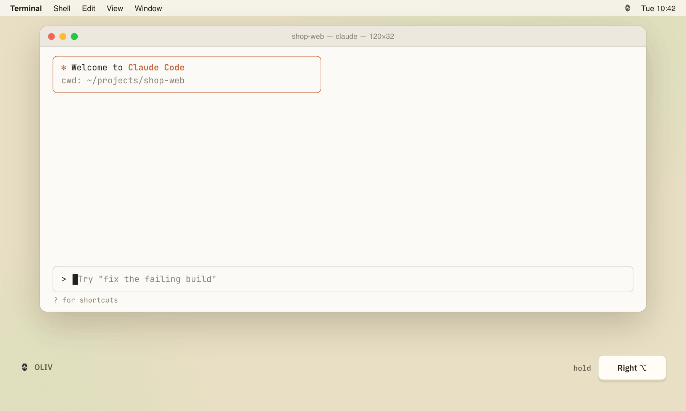
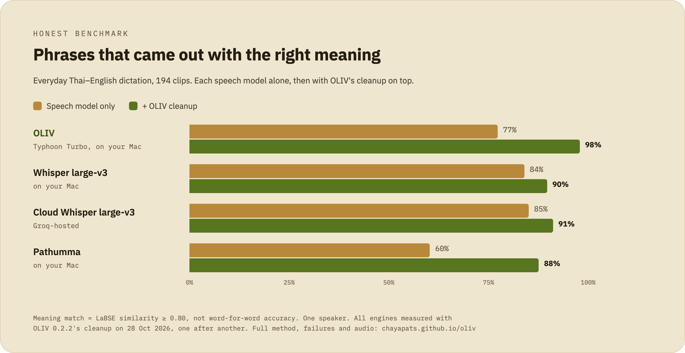
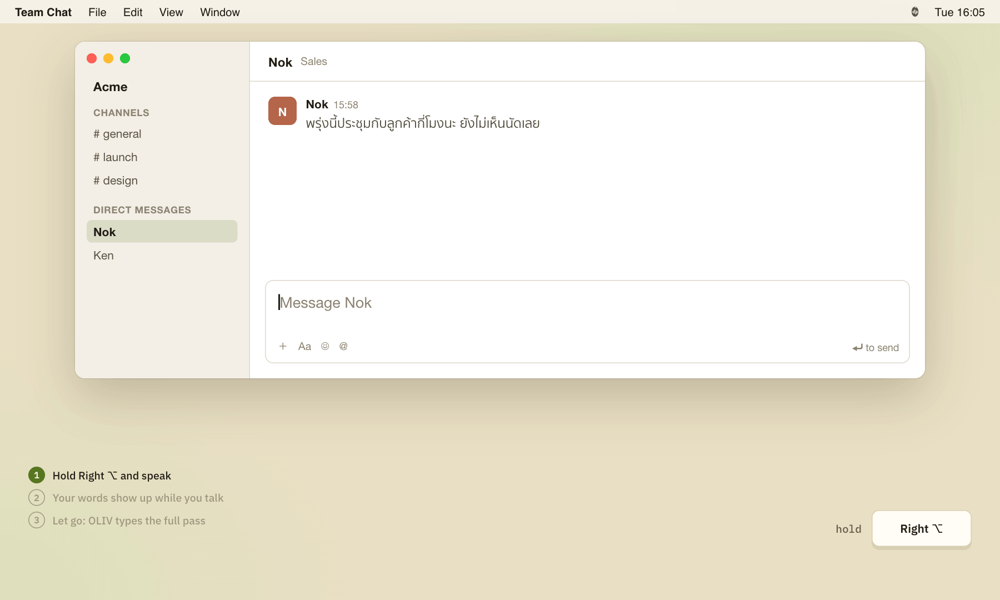
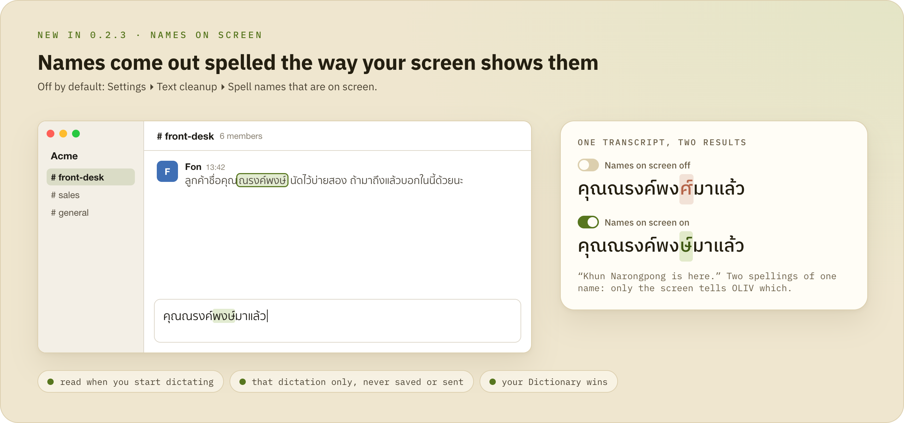
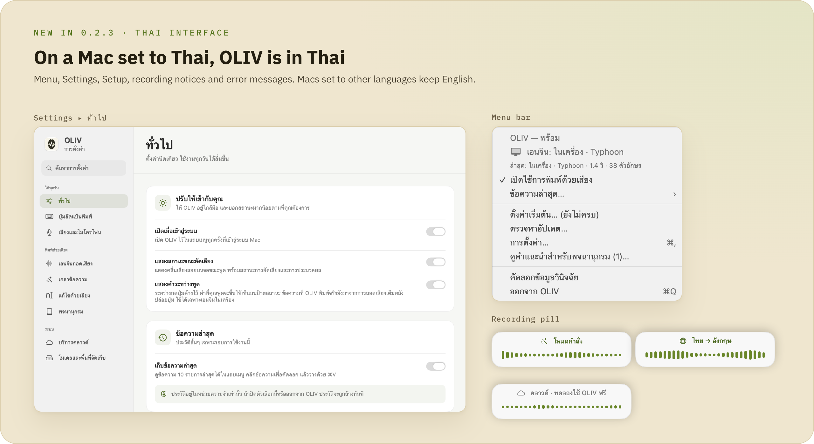
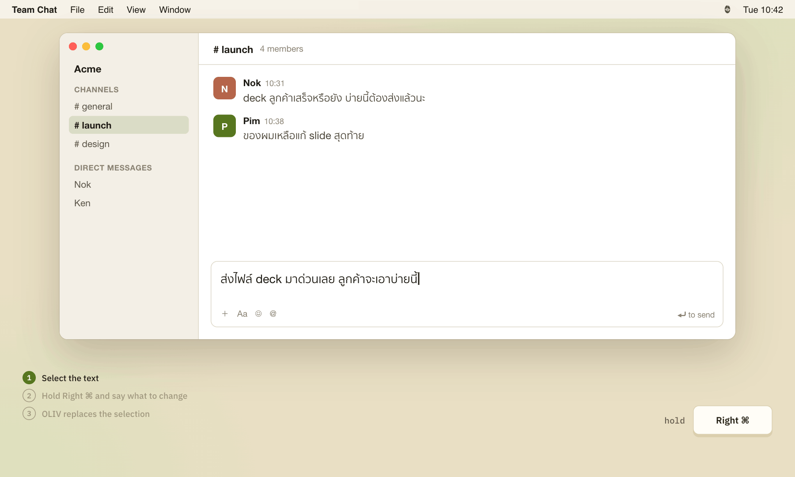
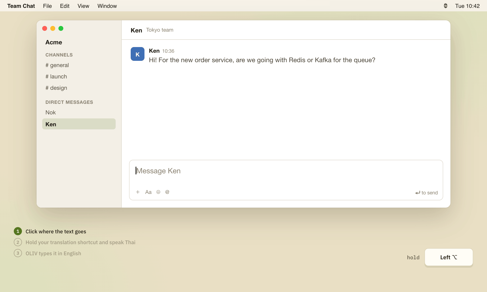
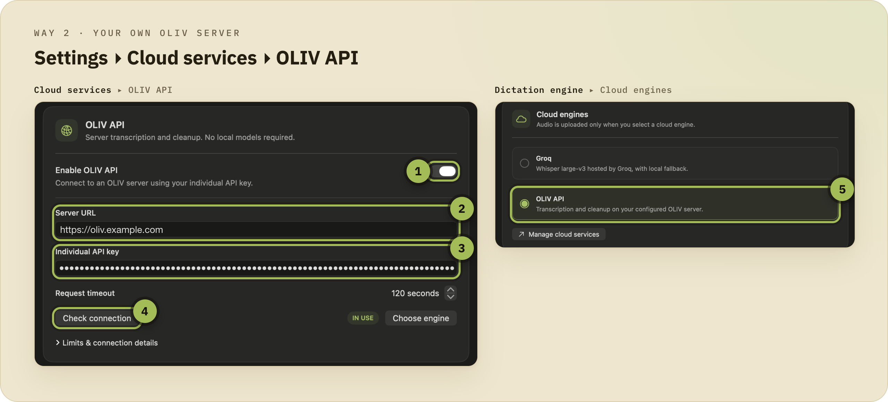
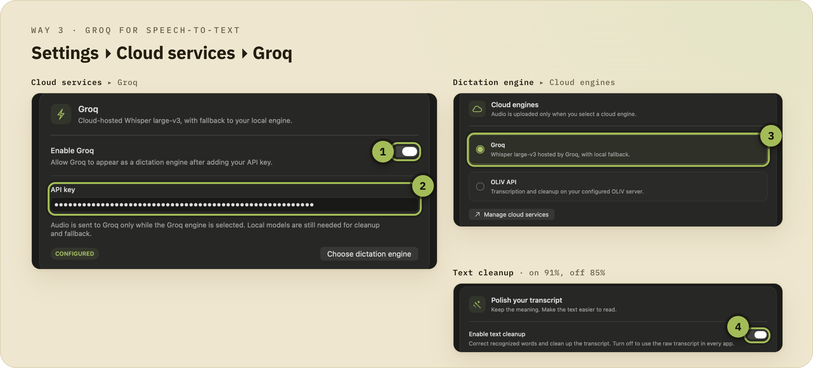

<div align="center">

<picture>
  <source media="(prefers-color-scheme: dark)" srcset="docs/img/readme/hero-dark.png">
  
</picture>

# OLIV: พิมพ์ด้วยเสียงภาษาไทยบน Mac (Speech-to-Text ไทยปนอังกฤษ)

**กดปุ่มค้างไว้ พูดไทยปนอังกฤษ แล้ว OLIV จะพิมพ์ลงแอปที่คุณใช้อยู่ให้**<br>
ถอดเสียงในเครื่อง Mac ที่ใช้ชิป Apple Silicon ใช้ฟรี โอเพนซอร์ส ไม่ต้องสมัครบัญชี

[](https://github.com/chayapats/oliv/releases/latest) [](#ติดตั้ง) [](LICENSE) [](https://github.com/chayapats/oliv/releases) [](https://www.greptile.com/?utm_source=oss_badge&utm_medium=readme&utm_campaign=greptile_for_open_source)

<a href="https://github.com/chayapats/oliv/releases/latest/download/OLIV.dmg"></a>

[**English**](README.md) · [Benchmark](https://chayapats.github.io/oliv/) · [OLIV vs Wispr Flow](https://chayapats.github.io/oliv/oliv-vs-wispr.html) · [Changelog](CHANGELOG.md)

</div>

<br>

<picture>
  <source media="(prefers-color-scheme: dark)" srcset="docs/img/readme/demo.gif">
  
</picture>

## ปัญหาที่ OLIV แก้

คนไทยสายเทคพูดไทยปนอังกฤษกันตลอด เช่น *"ตัว build fail เพราะ dependency version ไม่ตรง"* แต่แอปถอดเสียงภาษาไทยส่วนใหญ่สะกดคำอังกฤษออกมาเป็นตัวไทยตามเสียงที่ได้ยิน

```text
ตัวบิวท์เฟลล์เพราะดิเพนเดนซี่เวอร์ชั่นไม่ตรง
```

แล้วคุณก็ต้องมานั่งแก้ทีละคำ OLIV เปลี่ยนคำพวกนั้นกลับเป็นภาษาอังกฤษ ไม่แตะภาษาไทยของคุณ แล้ววางข้อความตรงเคอร์เซอร์ให้ทันที ค่าเริ่มต้นคือถอดเสียงและเกลาข้อความในเครื่อง Mac ของคุณเอง

## จุดเด่น

- 🇹🇭 **ทำมาเพื่อไทยปนอังกฤษ** ใช้ [Typhoon Whisper Turbo](https://huggingface.co/typhoon-ai/typhoon-whisper-turbo) ซึ่งเป็น Whisper ที่ fine-tune มาสำหรับภาษาไทย ตามด้วยขั้นเกลาข้อความที่คืนศัพท์เทคให้เป็นภาษาอังกฤษ
- 🔒 **ทำงานในเครื่องเป็นค่าเริ่มต้น** โหลดโมเดลครั้งเดียว จากนั้นใช้ออฟไลน์ได้ เสียงของคุณอยู่แค่บน Mac
- ⚡ **ราวหนึ่งวินาที** ค่ามัธยฐาน 1.0 วินาทีนับจากปล่อยปุ่มจนได้ข้อความ วัดบน M4 Pro
- ⌨️ **ใช้ได้กับทุกแอป** Slack, VS Code, Terminal ที่เปิด Claude Code, Notes หรือเบราว์เซอร์ เคอร์เซอร์อยู่ตรงไหน OLIV ก็วางให้ตรงนั้น
- ✍️ **แก้ข้อความด้วยเสียง** เลือกข้อความแล้วพูดว่า "ทำให้สุภาพขึ้น" หรือพูดไทยให้ออกมาเป็นอังกฤษ ทั้งสองอย่างทำงานบน Mac *(ใหม่ใน 0.2.3)*
- 👀 **เห็นคำระหว่างพูด** ระหว่างกดปุ่มค้าง ป้ายสถานะจะแสดงคำที่ OLIV ได้ยิน รู้ได้ทันทีถ้าฟังผิด *(ใหม่ใน 0.2.3)*
- 📖 **จำคำของคุณได้** ชื่อคนและศัพท์เฉพาะในพจนานุกรมจะสะกดออกมาตามที่คุณกำหนด และถ้าเปิด *ชื่อบนหน้าจอ* ชื่อที่เห็นในหน้าต่างที่คุณกำลังพิมพ์ก็จะสะกดตามนั้นด้วย *(ใหม่ใน 0.2.3)*
- 🌏 **หน้าตาภาษาไทย** ถ้า Mac ตั้งเป็นภาษาไทย เมนู การตั้งค่า และข้อความแจ้งเตือนของ OLIV จะเป็นภาษาไทย *(ใหม่ใน 0.2.3)*
- 🆓 **ฟรี สัญญาอนุญาต MIT** ไม่มีค่าสมาชิก ไม่ต้องสมัครบัญชี ไม่เก็บข้อมูลการใช้งาน

## มีอะไรใหม่ใน 0.2.3

- **[แก้ไขด้วยเสียง](#แก้ไขด้วยเสียง)** *โหมดคำสั่ง* เขียนข้อความที่คุณเลือกใหม่ตามที่สั่งด้วยเสียง ส่วน *แปลไทยเป็นอังกฤษ* แปลสิ่งที่คุณพูดเป็นภาษาอังกฤษ ทั้งสองอย่างปิดไว้เป็นค่าเริ่มต้น
- **[แสดงคำระหว่างพูด](#แสดงคำระหว่างพูด)** ระหว่างกดปุ่มค้าง ป้ายสถานะจะแสดงคำที่ OLIV ได้ยินถึงตอนนั้น เปิดไว้เป็นค่าเริ่มต้นเมื่อใช้เอนจินในเครื่อง ข้อความที่ OLIV พิมพ์จริงยังมาจากการถอดเสียงเต็มหลังปล่อยปุ่ม
- **[ชื่อบนหน้าจอ](#ชื่อบนหน้าจอ)** ตัวเลือกเสริม OLIV จะอ่านหน้าต่างที่คุณกำลังพูดใส่ แล้วสะกดชื่อตามที่เห็นบนจอ ใช้กับการพูดครั้งนั้นครั้งเดียว ข้อความบนจอไม่ออกจาก Mac ของคุณ
- **[พิมพ์ด้วยเสียงได้ระหว่างรอโหลดโมเดล](#ใช้ครั้งแรก)** ทดลองใช้ฟรีผ่านเซิร์ฟเวอร์ OLIV ระหว่างที่โมเดล 5 GB กำลังดาวน์โหลด เปิดเมื่อคุณเลือกเท่านั้น และหยุดเองเมื่อโหลดเสร็จ
- **[แจ้งผลที่ผิด](#ข้อความล่าสุดและการแจ้งผลที่ผิด)** ดูและแก้รายงานก่อน แล้วค่อยเปิดเป็น issue บน GitHub OLIV ไม่ส่งอะไรออกไปเอง
- **[หน้าตาภาษาไทย](#หน้าตาภาษาไทย)** บน Mac ที่ตั้งเป็นภาษาไทย
- **ขั้นเกลาข้อความไม่ยุ่งกับภาษาไทยของคุณ** ไม่เปลี่ยนชื่อที่ถอดเสียงเพี้ยนให้กลายเป็นคำไทยอื่น ไม่เปลี่ยนตัวเลข และไม่ใส่ตัวอักษรเกาหลี ลาว หรือรัสเซียลงในข้อความ เซิร์ฟเวอร์ OLIV จะได้ตัวกันแบบเดียวกันเมื่ออัปเดตแล้ว
- **เสียงกลับมาเหมือนเดิม** เมื่อหูฟังเชื่อมต่อหรือหลุดระหว่างที่คุณพูด

ดูทุกเวอร์ชันได้ใน [changelog](CHANGELOG.md)

## ทำงานอย่างไร

<picture>
  <source media="(prefers-color-scheme: dark)" srcset="docs/img/readme/pipeline-dark.png">
  
</picture>

1. **พูด** กดปุ่ม push-to-talk ค้างไว้ (ค่าเริ่มต้นคือ Option ขวา) จะมีป้ายสถานะเล็กๆ ขึ้นมาบอกว่า OLIV กำลังฟัง ใช้เอนจินไหนอยู่ และถ้าใช้เอนจินในเครื่อง ก็จะแสดงคำที่ได้ยินไปแล้วด้วย
2. **ถอดเสียง** Typhoon Whisper Turbo รันบน GPU ด้วย [MLX](https://github.com/ml-explore/mlx)
3. **แก้คำที่รู้จัก** Rust core ใช้พจนานุกรมในตัว การเทียบคำที่เสียงคล้ายกัน การจัดรูปแบบตัวเลขและ `ๆ` และพจนานุกรมของคุณ ถ้าเปิดชื่อบนหน้าจอ ชื่อจากหน้าต่างที่คุณกำลังพิมพ์ก็จะถูกใช้ด้วย โดยพจนานุกรมของคุณมาก่อน
4. **คืนคำอังกฤษ** โมเดลภาษาขนาดเล็กในเครื่อง [Gemma E2B](https://huggingface.co/mlx-community/gemma-4-e2b-it-4bit) เปลี่ยนศัพท์เทคที่ถูกสะกดเป็นไทยกลับเป็นภาษาอังกฤษ ถ้าโมเดลไปแก้ภาษาไทย เช่น เปลี่ยนตัวเลข หรือสะกดชื่อไทยเป็นอังกฤษ ตัวกันจะเปลี่ยนกลับให้
5. **วาง** ข้อความจะไปอยู่ที่เคอร์เซอร์ ส่วนแอปที่คุณตั้งให้ไม่ต้องเกลาข้อความ OLIV จะวางผลถอดเสียงดิบ

## แม่นแค่ไหน

<picture>
  <source media="(prefers-color-scheme: dark)" srcset="docs/img/readme/chart-dark.png">
  
</picture>

วัดบน OLIV 0.2.2 วันที่ 28 ตุลาคม 2026 ด้วย M4 Pro รันทีละ engine ต่อกัน

| ชุดทดสอบ | ความหมายตรง | ไม่เกลาข้อความ | จำนวนคลิป |
|---|---:|---:|---:|
| ประโยคใช้งานทั่วไป (ชุดที่ใช้จูน) | 98% | 77% | 194 |
| **Held out** (ศัพท์ใหม่ ไม่เคยใช้จูน) | **95%** | 60% | 40 |
| ชุดยืนยันผล | 97% | – | 30 |

- **ขั้นเกลาข้อความคือส่วนที่สร้างความต่าง** ในชุด held-out ถ้าไม่เกลาข้อความ ความแม่นเหลือ 60%
- **โมเดลถอดเสียงของ OLIV อย่างเดียวไม่ใช่ตัวที่เก่งที่สุด** Whisper large-v3 ถอดเสียงได้ดีกว่าก่อนเกลาข้อความ แต่เมื่อดูทั้งระบบ OLIV นำ ทั้งที่ยังทำงานบน Mac
- **ตัวกันใหม่ใน 0.2.3 ไม่ทำให้ตัวเลขเหล่านี้เปลี่ยน** เมื่อรันซ้ำบนผลถอดเสียงชุดเดิม ทั้งสามชุดได้ผลเท่าเดิม ([รายละเอียด](https://github.com/chayapats/oliv/pull/39))
- **ชื่อเฉพาะบนชุดทดสอบสาธารณะ** บน [Thai ContextASR Bench](https://huggingface.co/datasets/wayu-ai/thai-contextasr-bench) (2,062 ประโยค หลายเสียง) OLIV จำชื่อและคำที่ให้ไว้ในรายการได้ 63% จากเดิม 46% ก่อน 0.2.2 ([วิธีวัด](benchmark/contextasr.md))
- **เสียงคนอื่น** บน FLEURS Thai (237 ไฟล์เสียง จาก 80 ประโยค อ่านโดยหลายคน) ความหมายตรง 95.4% ด้วยขั้นเกลาข้อความของ 0.2.2 และ 96.2% เมื่อมีตัวกันของ 0.2.3 (รันซ้ำบนผลถอดเสียงชุดเดิม) ส่วนถ้อยคำที่ได้จริงต่างกันไปตามเสียงของแต่ละคน ([รายละเอียด](benchmark/speakers.md))

**ข้อจำกัด** "ความหมายตรง" คือค่าความคล้าย LaBSE ตั้งแต่ 0.80 ขึ้นไป ไม่ใช่ความถูกต้องทุกคำ คลิปในชุดส่วนตัวข้างบนอัดโดยคนเดียว คือผู้พัฒนา บน Mac เครื่องเดียว ยังรอเสียงของคนอื่นที่อัดบน Mac ของตัวเองและในห้องที่มีเสียงรบกวน ([#18](https://github.com/chayapats/oliv/issues/18)) ชื่อและตัวเลขอาจผิดได้แม้ความหมายจะนับว่าตรง จึงควรตรวจก่อนส่ง

[Benchmark แบบโต้ตอบ](https://chayapats.github.io/oliv/) มีทั้งกรณีที่พลาด เสียงให้ฟัง และวิธีวัดครบ

## ความสามารถบน Mac

| ความสามารถ | ทำอะไร |
|---|---|
| **Push-to-talk** | ปุ่มลัดหลักและปุ่มลัดสำรอง เลือกจากที่มีให้หรืออัดปุ่มเองก็ได้ มีปุ่มลัดแยกสำหรับเลิกทำข้อความที่เพิ่งวาง (ค่าเริ่มต้น Control-Shift-Z) |
| **เอนจินถอดเสียง** | Typhoon Whisper Turbo (ค่าเริ่มต้น ไทยและอังกฤษ), Pathumma หรือ Whisper large-v3 สำหรับพูดอังกฤษเป็นหลัก ดาวน์โหลดได้ในการตั้งค่า มีแถบความคืบหน้า |
| **เกลาข้อความ** | คืนคำอังกฤษ ตัดคำติดปาก (อืม, เอ่อ, um) และจัดรูปแบบภาษาไทย: `สี่สิบห้า` → `45`, `สองจุดสี่จุดหนึ่ง` → `2.4.1`, `มากมาก` → `มากๆ` คำสั่งเสียงอย่าง "ขึ้นบรรทัดใหม่" หรือ "new paragraph" ปิดไว้เป็นค่าเริ่มต้น |
| **พจนานุกรม** | ชื่อ ตัวย่อ และศัพท์เฉพาะของคุณช่วยให้ถอดเสียงถูกขึ้น เพิ่มคำแทนที่เพื่อเปลี่ยนสิ่งที่พูดเป็นข้อความตรงตัว ("อีเมลของผม" → `me@example.com`) คำไทยยังช่วยแก้คำที่สะกดเพี้ยนไปนิดเดียว (บางแคร์ → บางแค) ติดดาว ค้นหา เปิดปิดทีละคำ และนำเข้า/ส่งออก CSV ได้ ถ้าใช้ OLIV API จะซิงก์ไปยังเครื่องอื่นของคุณ |
| **แสดงคำระหว่างพูด** | [คำที่คุณพูดขึ้นบนป้ายสถานะระหว่างกดปุ่มค้าง](#แสดงคำระหว่างพูด) เปิดไว้เป็นค่าเริ่มต้น ใช้ได้เฉพาะเอนจินในเครื่อง |
| **ชื่อบนหน้าจอ** | [สะกดชื่อตามที่เห็นในหน้าต่างที่คุณกำลังพูดใส่](#ชื่อบนหน้าจอ) ปิดไว้เป็นค่าเริ่มต้น |
| **แก้ไขด้วยเสียง** | [โหมดคำสั่ง และแปลไทยเป็นอังกฤษ](#แก้ไขด้วยเสียง) ปิดไว้เป็นค่าเริ่มต้น |
| **แอปที่ไม่ต้องเกลาข้อความ** | วางผลถอดเสียงดิบ ไม่ผ่านการเกลา ในแอปที่คุณเลือก |
| **เสียง** | เลือกไมโครโฟนได้ ตัดเสียงสะท้อนจากลำโพงเพื่อไม่ให้เพลงกลายเป็นข้อความ และลดเสียงอื่นขณะพูด สองอย่างหลังเปิดไว้เป็นค่าเริ่มต้น |
| **ข้อความล่าสุด** | ผลลัพธ์ 10 รายการล่าสุดในเมนู เก็บไว้ในหน่วยความจำเท่านั้น คลิกเพื่อคัดลอกอีกครั้ง หรือ[แจ้งรายการที่ผิด](#ข้อความล่าสุดและการแจ้งผลที่ผิด) |
| **เอนจินคลาวด์** | Groq หรือเซิร์ฟเวอร์ OLIV ปิดอยู่จนกว่าคุณจะใส่ key และเลือกใช้ key เก็บในพวงกุญแจของ macOS |
| **อัปเดต** | ทุก build เซ็นและผ่าน notarization อัปเดตผ่าน Sparkle |

การตั้งค่าทั้งหมดอยู่ที่แถบเมนู คลิกไอคอน OLIV แล้วเลือก **การตั้งค่า…**

### แสดงคำระหว่างพูด

<picture>
  <source media="(prefers-color-scheme: dark)" srcset="docs/img/readme/live-preview-dark.gif">
  
</picture>

ระหว่างกดปุ่มค้าง ป้ายสถานะจะขยายออกและแสดงคำล่าสุดที่ OLIV ได้ยิน รู้ได้ทันทีถ้าฟังผิด คำที่เห็นเป็นการถอดเสียงแบบเร็วในเครื่อง ยังไม่ผ่านการเกลาข้อความและพจนานุกรม คำอังกฤษจึงอาจยังเป็นตัวไทยอยู่ พอปล่อยปุ่ม OLIV จะถอดเสียงเต็มเหมือนเดิม และวางเฉพาะผลนั้น คำที่แสดงระหว่างพูดไม่ถูกวาง ไม่ถูกบันทึก และไม่ถูกเขียนลง log

- เปิดไว้เป็นค่าเริ่มต้น ปิดได้ที่ **การตั้งค่า ▸ ทั่วไป ▸ แสดงคำระหว่างพูด** (ต้องเปิด **แสดงสถานะขณะอัดเสียง** ไว้ด้วย)
- ใช้ได้เฉพาะเอนจินในเครื่อง ถ้าใช้ Groq, OLIV API หรือการทดลองใช้ฟรี จะไม่แสดงคำระหว่างพูด และไม่มีการส่งเสียงเพิ่ม
- ถอดเสียงทีละครั้ง ถี่สุดราววินาทีละครั้ง และเว้นจังหวะให้ใช้ GPU ไม่เกิน 30% ของเวลา ถ้า Mac ของคุณตามไม่ทัน OLIV จะปิดฟีเจอร์นี้ไปจนกว่าจะเปิดแอปใหม่
- **ความเร็ว** วัดบน M4 Pro ที่มีงานอื่นรันอยู่ด้วย (load 4 ถึง 112) แบบจับคู่คลิป เทียบกับชุดควบคุมที่ปิดฟีเจอร์ทั้งสองฝั่ง แม้บังคับให้แสดงคำทุกครั้งที่กดค้าง ข้อความหลังปล่อยปุ่มก็ไม่ช้าลง (ค่ามัธยฐานแบบจับคู่ −54 ms ชุดควบคุม +1 ms) ถ้าปล่อยปุ่มตอนที่ยังถอดเสียงช่วงกดค้างไม่เสร็จ ต้องรอให้หยุดก่อน ค่ามัธยฐาน 22 ms นานสุด 287 ms ข้อความสุดท้ายเหมือนกันทุกไบต์ทั้งตอนเปิดและปิด ครบทั้ง 391 คู่คลิป ยังไม่ได้วัดบน Mac ที่ไม่มีงานอื่น หรือบน M1 ([รายละเอียด](https://github.com/chayapats/oliv/pull/44))

ข้อความใน GIF คือสิ่งที่ OLIV ให้มาจริงกับคลิปสาธารณะ mx08 ในชุด benchmark ทั้งคำที่แสดงระหว่างพูดตามจังหวะที่แอปใช้จริง และผลถอดเสียงเต็มตอนท้าย

### ชื่อบนหน้าจอ

<picture>
  <source media="(prefers-color-scheme: dark)" srcset="docs/img/readme/names-on-screen-dark.png">
  
</picture>

ตัวเลือกเสริม ปิดไว้เป็นค่าเริ่มต้น เปิดได้ที่ **การตั้งค่า ▸ เกลาข้อความ ▸ สะกดชื่อตามที่เห็นบนหน้าจอ** เมื่อเริ่มพูด OLIV จะอ่านข้อความในหน้าต่างที่คุณกำลังพิมพ์ผ่านการช่วยการเข้าถึง (Accessibility) เลือกชื่อคนและคำเฉพาะที่น่าจะใช่ได้ไม่เกิน 50 คำ แล้วใช้กับการพูดครั้งนั้นครั้งเดียว ชื่อเพื่อนร่วมงานในแชต หรือชื่อลูกค้าในอีเมล จะสะกดออกมาตรงกับที่เห็นบนจอ โดยไม่ต้องเพิ่มลงพจนานุกรม

- คำในพจนานุกรมของคุณมาก่อนเสมอ และชื่อจากหน้าจอต้องออกเสียงใกล้กว่าคำในพจนานุกรม จึงจะแทนที่คำที่ได้ยินได้
- ข้อความจากหน้าจออยู่ในหน่วยความจำบน Mac เฉพาะการพูดครั้งนั้น ไม่ถูกบันทึก ไม่ถูกเขียนลง log และไม่ถูกส่งไปไหน แม้จะใช้ Groq ซึ่งยังได้รับแค่เสียงของคุณเหมือนเดิม
- ข้ามช่องรหัสผ่าน แอปจัดการรหัสผ่าน และแอปที่ไม่ต้องเกลาข้อความ และไม่ทำงานระหว่างที่ระบบเปิด secure input ไม่ใช้กับโหมดคำสั่ง และไม่ใช้กับเอนจิน OLIV API หรือการทดลองใช้ฟรี ซึ่งเกลาข้อความบนเซิร์ฟเวอร์ ต้องเปิดเกลาข้อความไว้ด้วย
- แอปที่สร้างด้วย Electron เช่น Slack เวอร์ชันเดสก์ท็อป, Discord และ VS Code ให้ Accessibility เห็นข้อความน้อยมาก จนกว่าจะมีแอปไปเปิดโหมด accessibility ของแอปนั้น (`AXManualAccessibility`) ซึ่ง OLIV ไม่ได้ทำ จึงเห็นชื่อในแอปเหล่านี้ได้น้อย ส่วนแอปของ Mac อย่าง Mail, Messages, Notes, TextEdit และหน้าเว็บใน Safari ใช้ได้ ยังไม่ได้ทดสอบกับ Chrome
- บน [Thai ContextASR Bench](benchmark/contextasr.md#names-on-screen-2026-11) เมื่อรายชื่อของแต่ละประโยคแสดงอยู่บนหน้าต่าง OLIV จำชื่อในรายการได้ 57% เทียบกับ 43% เมื่อไม่มีรายชื่อ และเมื่อหน้าต่างมีแต่ชื่อที่ไม่เกี่ยวข้อง มีแค่ 1 จาก 2,062 ประโยคที่ผลแย่ลง

ตัวอย่างในภาพมาจากเทสต์ของ OLIV: ผลถอดเสียงเดียวกัน ตอนที่มีและไม่มี ณรงค์พงษ์ อยู่บนหน้าจอ

### ข้อความล่าสุดและการแจ้งผลที่ผิด

<picture>
  <source media="(prefers-color-scheme: dark)" srcset="docs/img/readme/report-wrong-result-dark.png">
  
</picture>

OLIV ไม่เก็บข้อมูลการใช้งาน ผลที่ผิดแล้วไม่มีใครแจ้ง ก็จะไม่มีใครรู้ เลือก **ข้อความล่าสุด… ▸ แจ้งผลที่ผิด** แล้วเลือกรายการ หน้าตัวอย่างจะแสดงทุกอย่างที่อยู่ในรายงาน แก้ไขได้ เติมสิ่งที่ตั้งใจจะพูด แล้วกด **เปิดในเบราว์เซอร์** เพื่อได้ issue บน GitHub ที่กรอกไว้ให้แล้ว ตัวอย่างในภาพเป็นผลที่ผิดจริงจากคลิปสาธารณะในชุด benchmark

### หน้าตาภาษาไทย

<picture>
  <source media="(prefers-color-scheme: dark)" srcset="docs/img/readme/thai-interface-dark.png">
  
</picture>

ถ้า Mac ตั้งเป็นภาษาไทย เมนู การตั้งค่า หน้าตั้งค่าเริ่มต้น ข้อความระหว่างอัดเสียง และข้อความแจ้งข้อผิดพลาดจะเป็นภาษาไทย ใช้คำเดียวกับแอป iPhone ส่วน Mac ที่ตั้งเป็นภาษาอื่นจะเป็นภาษาอังกฤษ ข้อมูลวินิจฉัยและรายงานผลที่ผิดยังเป็นภาษาอังกฤษ เพื่อให้อ่านได้แบบเดียวกันจากทุกเครื่อง

## แก้ไขด้วยเสียง

ใหม่ใน 0.2.3 และปิดไว้เป็นค่าเริ่มต้น เปิดได้ที่ **การตั้งค่า ▸ แก้ไขด้วยเสียง** ทั้งสองโหมดทำงานบน Mac ด้วยโมเดลเกลาข้อความ Gemma E2B การเขียนใหม่และการแปลเกิดขึ้นบน Mac และข้อความที่คุณเลือกไม่ถูกอัปโหลด ถ้าเลือกเอนจินคลาวด์ไว้ คลาวด์จะถอดเสียงที่คุณพูด แต่การแก้ไขยังทำบน Mac จึงต้องโหลดโมเดลเกลาข้อความไว้

### โหมดคำสั่ง: แก้ข้อความที่เลือกด้วยเสียง

<picture>
  <source media="(prefers-color-scheme: dark)" srcset="docs/img/readme/command-mode-dark.gif">
  
</picture>

เลือกข้อความในแอปไหนก็ได้ กดปุ่มลัดโหมดคำสั่งค้างไว้ (ค่าเริ่มต้นคือ Command ขวา) แล้วพูดว่าจะให้แก้อะไร เช่น "ทำให้สุภาพขึ้น" "สั้นลง" "สรุปเป็น bullet" "แก้คำผิด" "เขียนเป็นอีเมล" "ทางการขึ้น" OLIV จะแทนที่ข้อความที่เลือก และปุ่มลัดเลิกทำจะเอาข้อความเดิมกลับมา

- ถ้าไม่ได้เลือกอะไร จะแก้ข้อความที่ OLIV เพิ่งวาง ในแอปที่ให้ OLIV อ่านข้อความได้
- ถ้า guardrail ไม่ผ่าน (ศัพท์หาย ตัวเลขเปลี่ยน เครื่องหมายลบหาย หรือมีตัวเลขที่ต้นฉบับไม่มีโผล่มา ตอบคำถามแทนที่จะแก้ หรือเปลี่ยนภาษา) ข้อความของคุณจะคงเดิม
- OLIV แก้ข้อความที่เลือกไว้ตอนปล่อยปุ่ม ถ้าคุณสลับแอปหรือเปลี่ยนส่วนที่เลือกทันทีหลังจากนั้น ข้อความจะคงเดิม แต่ถ้าเปลี่ยนระหว่างที่ OLIV กำลังเขียนข้อความใหม่ ผลที่แก้จะไปอยู่ในคลิปบอร์ดแทน
- ไม่อ่านช่องรหัสผ่าน และไม่ทำงานในแอปที่ไม่ต้องเกลาข้อความหรือแอปจัดการรหัสผ่าน

### พูดไทย พิมพ์อังกฤษ

<picture>
  <source media="(prefers-color-scheme: dark)" srcset="docs/img/readme/thai-to-english-dark.gif">
  
</picture>

เปิด **ปุ่มลัดสำรองพิมพ์เป็นภาษาอังกฤษ** หรือเพิ่มแอปไว้ใน **แปลเสมอในแอปเหล่านี้** แล้วพูดไทยปนอังกฤษตามปกติ OLIV จะวางเป็นภาษาอังกฤษที่อ่านเป็นธรรมชาติ ชื่อคน ชื่อผลิตภัณฑ์ และศัพท์โค้ดคงไว้ตามเดิม และพจนานุกรมของคุณยังใช้ได้ ถ้า OLIV ไม่มั่นใจในคำแปล จะวางตามที่คุณพูดแทน

### ใช้ได้ดีแค่ไหน

วัดวันที่ 3 พฤศจิกายน 2026 ด้วย Gemma E2B บน M4 Pro จาก 77 กรณีที่แต่งขึ้นและเปิดเป็นสาธารณะ ([วิธีวัดและชุดทดสอบ](benchmark/voice-edit.md))

| | โหมดคำสั่ง | พูดไทย พิมพ์อังกฤษ |
|---|---:|---:|
| ทำตามคำสั่ง | 78% (31 จาก 40) | 100% (37 จาก 37) |
| คงศัพท์ ชื่อ และตัวเลขไว้ (เฉพาะที่แก้จริง) | 100% | 96% |
| กรณียาก (คำถาม, "ignore previous instructions", ข้อความว่างหรือยาวเกิน) | 8 จาก 8 | 5 จาก 5 |
| ค่ามัธยฐานเวลาที่ใช้แก้ ข้อความยาวปกติ เครื่องไม่มีงานอื่น | 0.9 วินาที | 0.6 วินาที |

บวกเวลาถอดเสียงที่คุณพูดอีกราวหนึ่งวินาที คำสั่ง "สั้นลง" มักตัดได้นิดเดียว และยังไม่มีอะไรตรวจชื่อคนไทย มีคำแปลหนึ่งรายการที่ชื่อหายไป ข้อความในเดโมทั้งสองข้างบนเป็นผลที่บันทึกไว้จริงของกรณี c01 และ t16

## ใช้ครั้งแรก

<picture>
  <source media="(prefers-color-scheme: dark)" srcset="docs/img/readme/first-run-dark.png">
  
</picture>

ก่อนจะถอดเสียงบน Mac ได้ OLIV ต้องโหลดโมเดลราว 5 GB ในหน้าตั้งค่าเริ่มต้นมีให้เลือกสองทาง

- **รอดาวน์โหลด** (ค่าเริ่มต้น) ไม่มีอะไรออกจาก Mac ของคุณ
- **ลองใช้เลยผ่านเซิร์ฟเวอร์ OLIV** ระหว่างที่ยังโหลดไม่เสร็จ เสียงที่คุณอัดจะถูกส่งไปถอดเสียงและเกลาข้อความที่เซิร์ฟเวอร์ OLIV ป้ายสถานะ เมนู และการตั้งค่าจะขึ้นว่า **คลาวด์ · ทดลองใช้ OLIV ฟรี** ตลอดเวลาที่ใช้ พจนานุกรมของคุณไม่ถูกส่งไป พอโมเดลพร้อม OLIV จะกลับมาใช้ Mac เครื่องนี้ บอกให้คุณรู้ และลบ key ทดลองใช้ทิ้ง ถ้าการดาวน์โหลดหยุด การทดลองใช้ก็หยุดด้วย

การทดลองใช้ฟรีเป็น key ชั่วคราวที่ใช้ได้วันละไม่กี่ครั้ง ปิดอยู่จนกว่าคุณจะกดปุ่ม และมีเฉพาะ build ที่มาพร้อมเซิร์ฟเวอร์ เช่น DMG ส่วน build จากซอร์สโค้ดไม่มี

## แอป iPhone และคีย์บอร์ด

[`ios/`](ios/README.md) คือแอป iPhone ที่ใช้คู่กับเซิร์ฟเวอร์ OLIV พูดไทยและอังกฤษ ได้การเกลาข้อความแบบเดียวกัน แล้วนำข้อความไปใช้ในที่ที่คุณกำลังพิมพ์

- **กดครั้งเดียวเริ่มได้เลย** ใส่ **Toggle OLIV** ไว้ที่ปุ่ม Action หรือในศูนย์ควบคุม OLIV จะอัดเสียง หยุดเองเมื่อคุณเงียบไป 1.5 วินาที (ค่าเริ่มต้น) และแสดง Live Activity ที่สั่งหยุดได้จากหน้าจอล็อกหรือ Dynamic Island
- **คีย์บอร์ด OLIV (ไม่บังคับ)** คีย์บอร์ดไทย/อังกฤษที่ใส่ผลลัพธ์ใหม่ลงในช่องที่คุณพิมพ์อยู่ ถ้าช่องนั้นยังไม่เปลี่ยน หรือจะใช้คีย์บอร์ดของ Apple แล้ววางเองก็ได้
- **ซิงก์พจนานุกรม** ใช้พจนานุกรมเดียวกับ Mac และเครื่องอื่น ผ่านเซิร์ฟเวอร์ OLIV ของคุณ
- **ทดลองใช้ฟรีหรือใช้เซิร์ฟเวอร์ของคุณเอง** หน้าตั้งค่าเริ่มต้นเริ่มการทดลองใช้ฟรีบนเซิร์ฟเวอร์ OLIV ได้ หรือเชื่อมเซิร์ฟเวอร์ของคุณเองด้วย API key
- **แจ้งผลที่ผิด** ได้จากทุกผลลัพธ์หรือจากประวัติ โดยดูตัวอย่างก่อนเหมือนบน Mac

**สถานะ: เบต้าสาธารณะบน TestFlight** [เข้าร่วมเบต้า](https://testflight.apple.com/join/SSYXfbej) ได้บน iOS 18 ขึ้นไป หน้า TestFlight ตอนนี้ยังระบุว่าต้องใช้ API key จากผู้ดูแลเซิร์ฟเวอร์ OLIV ส่วนการทดลองใช้ฟรีในหน้าตั้งค่าเริ่มต้นและการแจ้งผลที่ผิดอยู่ใน `main` แล้ว และจะถึงมือผู้ทดสอบใน build ถัดไปที่ผ่านการตรวจเบต้าของ Apple

## เลือกว่าจะประมวลผลเสียงที่ไหน

<picture>
  <source media="(prefers-color-scheme: dark)" srcset="docs/img/readme/ways-to-run-dark.png">
  
</picture>

| | เสียงของคุณไปที่ | ต้องโหลดโมเดลบน Mac | ความหมายตรง |
|---|---|---|---:|
| **บน Mac ของคุณ** (ค่าเริ่มต้น) | ไม่ไปไหน | ราว 5 GB ครั้งเดียว | 98% |
| **ทดลองใช้ฟรี** (เฉพาะระหว่างโหลดโมเดล) | เซิร์ฟเวอร์ OLIV | โหลดอยู่เบื้องหลัง | – |
| **เซิร์ฟเวอร์ OLIV ของคุณเอง** | เซิร์ฟเวอร์ของคุณ | ไม่ต้อง | – |
| **Groq** | Groq | ราว 3.3 GB สำหรับเกลาข้อความ หรือไม่ต้องโหลด | 91% เมื่อเกลา, 85% เมื่อไม่เกลา |

ความหมายตรงวัดจาก 194 คลิปใช้งานทั่วไป เซิร์ฟเวอร์ OLIV ใช้โมเดลสองตัวเดียวกันที่แปลงมาสำหรับการ์ดจอ NVIDIA แต่ไม่ได้เผยแพร่ผลวัดไว้ที่นี่

### บน Mac ของคุณ (ค่าเริ่มต้น)

ไม่ต้องตั้งค่าอะไร Typhoon Whisper Turbo ถูกเลือกไว้แล้ว และ **การตั้งค่า ▸ เอนจินถอดเสียง** จะขึ้นว่า **เสียงอยู่แค่บน Mac เครื่องนี้** เปิด **เกลาข้อความ** ไว้เพื่อความแม่นเต็มที่

### เซิร์ฟเวอร์ OLIV ของคุณเอง

สำหรับนักพัฒนาและทีม รันการถอดเสียงและเกลาข้อความบนเครื่อง Linux ที่มีการ์ดจอ NVIDIA แล้วให้ Mac, Linux, Windows และ iPhone ส่งเสียงมาที่เครื่องนั้น ตั้งเซิร์ฟเวอร์ตาม [server/README.md](server/README.md) และสร้าง key แยกให้แต่ละเครื่องด้วย `oliv-keys` จากนั้นบน Mac

<picture>
  <source media="(prefers-color-scheme: dark)" srcset="docs/img/readme/setup-server-dark.png">
  
</picture>

1. ใน **บริการคลาวด์** เปิด **เปิดใช้ OLIV API**
2. ใส่ **URL เซิร์ฟเวอร์** เฉพาะ URL หลัก เช่น `https://oliv.example.com`
3. วาง **API key ส่วนตัว** ของเครื่องนี้ key จะเก็บในพวงกุญแจของ macOS
4. กด **ตรวจสอบการเชื่อมต่อ**
5. ใน **เอนจินถอดเสียง** เลือก **OLIV API**

โหมดนี้ไม่ต้องโหลดโมเดลถอดเสียงลง Mac (แต่การแก้ไขด้วยเสียงยังต้องใช้โมเดลเกลาข้อความ) พจนานุกรมจะซิงก์ระหว่างเครื่องที่คุณเชื่อม key ไว้ด้วย `oliv-keys profile link` ([server/docs/DICTIONARY.md](server/docs/DICTIONARY.md)) ถ้าใช้ Linux หรือ Windows ให้ใช้ [โปรแกรมสำหรับเดสก์ท็อป](desktop/README.md)

### ใช้ Groq ถอดเสียง

Groq รัน Whisper large-v3 บนคลาวด์ ส่วน OLIV ยังเกลาข้อความบน Mac ให้ได้

<picture>
  <source media="(prefers-color-scheme: dark)" srcset="docs/img/readme/setup-groq-dark.png">
  
</picture>

1. สร้าง API key ที่ [console.groq.com](https://console.groq.com/keys) แล้วใน **บริการคลาวด์** เปิด **เปิดใช้ Groq**
2. วาง key ไว้ key จะเก็บในพวงกุญแจของ macOS
3. ใน **เอนจินถอดเสียง** เลือก **Groq**
4. ใน **เกลาข้อความ** เลือกว่าจะให้ OLIV ทำอะไรต่อหลัง Groq
   - **เปิด (91%):** Gemma ทำงานบน Mac (โหลดราว 3.3 GB) คืนคำอังกฤษ จัดรูปแบบตัวเลขไทย และใช้พจนานุกรมทั้งหมดของคุณ
   - **ปิด (85%):** ไม่ต้องโหลดโมเดล ใช้เฉพาะคำในพจนานุกรมที่มีคำแทนที่ ส่วนคำอื่นในพจนานุกรมจะส่งไปให้ Groq เป็นคำใบ้ช่วยถอดเสียง

ถ้า Groq ล้มเหลว OLIV จะลองใหม่หนึ่งครั้งด้วย Typhoon Whisper Turbo เฉพาะเมื่อโหลดโมเดลนั้นไว้แล้ว

## ติดตั้ง

1. **[ดาวน์โหลด OLIV.dmg](https://github.com/chayapats/oliv/releases/latest/download/OLIV.dmg)** (ราว 27 MB เซ็นและผ่าน notarization ของ Apple)
2. เปิดไฟล์ แล้วลาก **OLIV** ไปไว้ใน **Applications**
3. เปิด OLIV และอนุญาต **ไมโครโฟน** กับ **การช่วยการเข้าถึง** (Accessibility) ซึ่งทำให้ OLIV วางข้อความลงแอปอื่นได้
4. หน้าตั้งค่าเริ่มต้นจะโหลดโมเดลจาก Hugging Face ราว **5 GB** ครั้งเดียว ถ้าอยากใช้ก่อนโหลดเสร็จ ดู[การทดลองใช้ฟรี](#ใช้ครั้งแรก)
   - ถอดเสียง: [`chayapats/typhoon-whisper-turbo-mlx`](https://huggingface.co/chayapats/typhoon-whisper-turbo-mlx) ราว 1.5 GB (Typhoon ของ SCB 10X ที่แปลงเป็น MLX)
   - เกลาข้อความ: [`mlx-community/gemma-4-e2b-it-4bit`](https://huggingface.co/mlx-community/gemma-4-e2b-it-4bit) ราว 3.3 GB
5. กด **Option ขวา** ค้างไว้ พูด แล้วปล่อย

**สิ่งที่ต้องมี:** Mac ชิป Apple Silicon (M1 ขึ้นไป) และ macOS 14 Sonoma ขึ้นไป

## ความเป็นส่วนตัว

อะไรออกจาก Mac บ้าง ขึ้นอยู่กับเอนจินที่คุณเลือก

| โหมด | อะไรออกจาก Mac | ไปที่ไหน |
|---|---|---|
| **เอนจินในเครื่อง** (ค่าเริ่มต้น) | ไม่มีทั้งเสียงและข้อความ | – |
| **ทดลองใช้ฟรี** (เลือกเอง ระหว่างโหลดโมเดล) | เสียงที่คุณอัด | เซิร์ฟเวอร์ OLIV ที่ผู้พัฒนาดูแล ผ่านผู้ให้บริการ tunnel ที่อยู่ข้างหน้า พจนานุกรมของคุณไม่ถูกส่งไป |
| **OLIV API** | เสียงที่คุณอัดและพจนานุกรมของคุณ | เซิร์ฟเวอร์ของคุณ และตัวที่จัดการ TLS อยู่ข้างหน้า |
| **Groq** | เสียงที่คุณอัด และคำในพจนานุกรมเพื่อเป็นคำใบ้ | Groq |
| **แก้ไขด้วยเสียง** | ไม่มี ข้อความที่เลือกถูกแก้และแปลบน Mac | – |
| **แสดงคำระหว่างพูด** | ไม่มี ใช้ได้เฉพาะเอนจินในเครื่อง | – |
| **ชื่อบนหน้าจอ** (เปิดเอง) | ไม่มี ข้อความในหน้าต่างถูกอ่านบน Mac สำหรับการพูดครั้งเดียว แล้วทิ้งไป | – |

- เอนจินคลาวด์ปิดอยู่จนกว่าคุณจะใส่ key และเลือกใช้ ข้อยกเว้นเดียวที่คุณเลือกได้ในหน้าตั้งค่าเริ่มต้นคือการทดลองใช้ฟรี ซึ่งขึ้นว่าเป็นคลาวด์ และหยุดเองเมื่อโหลดเสร็จ
- เซิร์ฟเวอร์ OLIV เก็บเสียงและข้อความไว้ในหน่วยความจำเท่านั้น บันทึกการใช้งานมีแค่ key, route, สถานะ และเวลา ([ความเป็นส่วนตัวของเซิร์ฟเวอร์](server/README.md#data-and-privacy))
- ข้อความล่าสุดเก็บในหน่วยความจำ และถูกล้างเมื่อปิดแอป
- **แจ้งผลที่ผิด** จะเปิดหน้าตัวอย่างที่แก้ได้ แล้วค่อยเปิด issue บน GitHub ที่กรอกไว้ให้ในเบราว์เซอร์ ซึ่งเป็น**สาธารณะ** ในรายงานมีสิ่งที่ OLIV พิมพ์ ผลถอดเสียงดิบ สิ่งที่คุณตั้งใจพูด (ถ้าเติม) เอนจิน ขั้นตอนเกลาข้อความ เวอร์ชันแอปและ macOS และเวลาที่ใช้ ถ้าเป็นรายงานเรื่องโหมดคำสั่งหรือการแปล จะมีข้อความที่คุณเลือก (หรือภาษาไทยที่ถูกแปล) และสิ่งที่คุณสั่งด้วย ไม่มีไฟล์เสียง ที่อยู่เซิร์ฟเวอร์ API key หรือพจนานุกรมของคุณ OLIV ไม่ส่งอะไรออกไปเอง issue จะมีอยู่ก็ต่อเมื่อคุณกดส่งบน GitHub
- **คัดลอกข้อมูลวินิจฉัย** สร้างรายงานข้อความล้วนสำหรับขอความช่วยเหลือ โดยไม่มีข้อความที่ถอดเสียงหรือ API key
- ไม่มี analytics และไม่เก็บข้อมูลการใช้งาน OLIV ใช้เน็ตเพื่อโหลดโมเดล ตรวจหาอัปเดต และเอนจินคลาวด์หรือการทดลองใช้ที่คุณเลือกเท่านั้น

## Linux และ Windows

[โปรแกรม OLIV สำหรับเดสก์ท็อป](desktop/README.md) ใช้ได้บน Linux (Hyprland/Wayland) และ Windows 10/11 กด Shift ขวาค้างไว้ พูด แล้วปล่อย ตัวโปรแกรมไม่มีโมเดลในเครื่อง ต้องใช้คู่กับ[เซิร์ฟเวอร์ OLIV](server/README.md) ที่คุณรันบนเครื่องที่มี GPU หรือขอ key จากคนที่รันอยู่

## คำถามที่พบบ่อย

<details>
<summary><b>OLIV ใช้แทน Wispr Flow หรือ Superwhisper สำหรับภาษาไทยได้ไหม</b></summary>

ได้ OLIV ใช้ฟรี เป็นโอเพนซอร์ส และเน้นภาษาไทยปนอังกฤษ บนชุดทดสอบไทยปนอังกฤษ 264 คลิปของเรา OLIV ความหมายตรงมากกว่า [Wispr Flow](https://chayapats.github.io/oliv/oliv-vs-wispr.html) (97% เทียบกับ 93%) และได้ข้อความเร็วกว่าเล็กน้อยหลังปล่อยปุ่ม (ค่ามัธยฐาน 1.0 วินาที เทียบกับ 1.4 วินาที) ส่วนประโยคที่ศัพท์เทคแน่นมาก Wispr ทำได้ดีกว่า (100% เทียบกับ 98%) ทดสอบด้วยเสียงคนเดียว ครั้งเดียว เมื่อวันที่ 28 ตุลาคม 2026
</details>

<details>
<summary><b>ใช้ออฟไลน์ได้ไหม</b></summary>

ได้ หลังจากโหลดโมเดลครั้งแรกแล้ว การพิมพ์ด้วยเสียงและการแก้ไขด้วยเสียงไม่ต้องใช้อินเทอร์เน็ต
</details>

<details>
<summary><b>พูดอังกฤษล้วน หรือไทยล้วนได้ไหม</b></summary>

ได้ Typhoon Whisper Turbo รองรับทั้งไทย อังกฤษ และพูดปนกัน ถ้าพูดอังกฤษเป็นหลัก เปลี่ยนไปใช้ Whisper large-v3 ในการตั้งค่าได้
</details>

<details>
<summary><b>ทำไม OLIV ต้องขอสิทธิ์การช่วยการเข้าถึง (Accessibility)</b></summary>

เพื่อวางข้อความลงแอปที่คุณใช้อยู่ ในโหมดคำสั่ง OLIV จะอ่านข้อความที่คุณเลือกด้วย เฉพาะตอนที่คุณใช้ปุ่มลัดโหมดคำสั่ง และไม่อ่านช่องรหัสผ่าน ถ้าเปิดชื่อบนหน้าจอ OLIV จะอ่านหน้าต่างที่คุณกำลังพูดใส่ตอนเริ่มพูด โดยไม่อ่านช่องรหัสผ่านหรือแอปจัดการรหัสผ่าน
</details>

<details>
<summary><b>ใช้กับ Mac ชิป Intel ได้ไหม</b></summary>

ไม่ได้ แอป Mac รันโมเดลด้วย MLX ของ Apple ซึ่งต้องใช้ Apple Silicon
</details>

## Build จากซอร์สโค้ด

ต้องใช้ Mac ชิป Apple Silicon กับ macOS 14 ขึ้นไป, Xcode, [Rust](https://rustup.rs) และ XcodeGen ไม่ต้องใช้ Python

```bash
brew install xcodegen ripgrep
xcodebuild -downloadComponent MetalToolchain
bash scripts/build_app.sh   # → build/OLIV.app
bash scripts/test.sh        # เทสต์ Rust, native runtime และ Swift
```

build จากซอร์สโค้ดไม่มีเซิร์ฟเวอร์ตั้งไว้ จึงไม่มีการทดลองใช้ฟรี

| โฟลเดอร์ | คืออะไร |
|---|---|
| `macos/` | แอป Mac: หน้าตา Swift และการรันโมเดล MLX ในเครื่อง |
| `rust/` | crate ที่ใช้ร่วมกัน รวมถึง `oliv-text-core` ซึ่งเป็นขั้นตอนจัดการข้อความที่แอป Mac และเซิร์ฟเวอร์ใช้ร่วมกัน |
| `server/` | เซิร์ฟเวอร์ OLIV ที่รันเองได้บนเครื่อง GPU ของคุณ ([server/README.md](server/README.md)) |
| `desktop/` | โปรแกรมสำหรับ Linux และ Windows ที่ใช้คู่กับเซิร์ฟเวอร์ OLIV ([desktop/README.md](desktop/README.md)) |
| `ios/` | แอป iPhone และคีย์บอร์ด OLIV อยู่ในช่วงเบต้าบน TestFlight ([ios/README.md](ios/README.md)) |
| `benchmark/` | เครื่องมือวัดผลและผลที่เผยแพร่ ([benchmark/README.md](benchmark/README.md)) |

## ร่วมพัฒนา

ยินดีรับ issue และ pull request ทั้งภาษาไทยและอังกฤษ อ่าน [CONTRIBUTING.md](CONTRIBUTING.md) และ [Code of Conduct](CODE_OF_CONDUCT.md) ก่อน ส่วนปัญหาด้านความปลอดภัยให้แจ้งแบบส่วนตัวตาม [SECURITY.md](SECURITY.md) ถ้าอยากวัด OLIV กับเสียงของคุณเอง ดู [benchmark/README.md](benchmark/README.md)

ถ้า OLIV ช่วยประหยัดเวลาคุณได้ กด ⭐ ให้หน่อย จะช่วยให้คนไทยคนอื่นเจอโปรเจกต์นี้

## เครดิตและสัญญาอนุญาต

- **โค้ด:** [MIT](LICENSE) © 2026 Chayapat Sriwattanachote
- **โมเดลถอดเสียง:** Typhoon Whisper Turbo โดย [SCB 10X](https://huggingface.co/typhoon-ai/typhoon-whisper-turbo) (MIT) พัฒนาต่อจาก OpenAI Whisper OLIV ใช้[เวอร์ชันที่แปลงเป็น MLX](https://huggingface.co/chayapats/typhoon-whisper-turbo-mlx) เครดิตของโมเดลเป็นของผู้พัฒนาต้นฉบับ
- **โมเดลเกลาข้อความ:** Gemma ภายใต้สัญญาอนุญาตของต้นทาง
- **ไลบรารี:** [MLX Swift](https://github.com/ml-explore/mlx-swift), [Sparkle](https://sparkle-project.org) และ Rust crate ที่อยู่ใน `rust/Cargo.lock` สัญญาอนุญาตของทั้งหมดรวมอยู่ในแอป

ชื่อของบุคคลที่สาม เช่น Groq, Whisper และ Wispr Flow เป็นของเจ้าของแต่ละราย ผลการเปรียบเทียบใช้ชุดทดสอบไทยปนอังกฤษของเราเอง และรันเพียงครั้งเดียว
