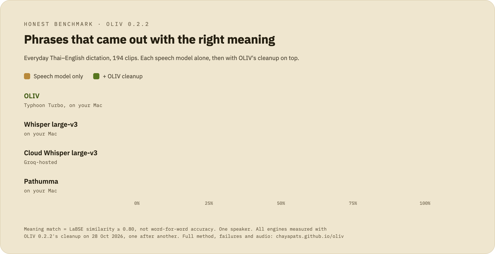
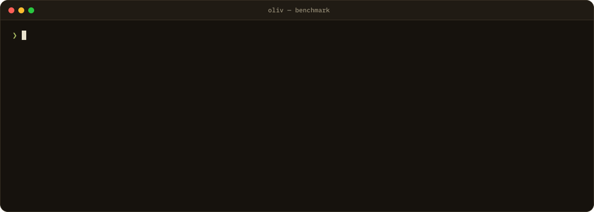

<div align="center">

<picture>
  <source media="(prefers-color-scheme: dark)" srcset="../docs/img/readme/bench-chart-dark.gif">
  
</picture>

# Native OLIV benchmarks

**The numbers on the OLIV site come from this CLI, and you can run it on your own recordings.**<br>
Rust + native MLX, the same pipeline the app ships. No Python, no Torch, no pip.

[Interactive results](https://chayapats.github.io/oliv/) · [OLIV vs Wispr Flow](https://chayapats.github.io/oliv/oliv-vs-wispr.html) · [Thai ContextASR Bench](contextasr.md) · [Main README](../README.md)

</div>

## Latest results (OLIV 0.2.2, 28 October 2026)

Every engine below was re-run one after another on the same Mac (M4 Pro), with
OLIV 0.2.2's cleanup. "Meaning match" is the share of clips whose LaBSE
similarity to the reference is at least 0.80.

| Test set | Clips | Meaning match | Without cleanup |
|---|---:|---:|---:|
| Everyday speech (tuning set) | 194 | **97.9%** | 77.3% |
| **Held out** (new jargon, never used for tuning) | 40 | **95.0%** | 60.0% |
| Confirmation | 30 | **96.7%** | – |
| All clips | 264 | **97.3%** | 71.2% |

| Speech engine (194 everyday clips) | Speech model only | + OLIV cleanup |
|---|---:|---:|
| **Typhoon Whisper Turbo** (OLIV default, on the Mac) | 77.3% | **97.9%** |
| Whisper large-v3 (on the Mac) | 84.0% | 89.7% |
| Whisper large-v3 (Groq-hosted) | 85.1% | 91.2% |
| Pathumma (on the Mac) | 60.3% | 87.6% |

On all 264 clips the full pipeline scores WER 0.145 and CER 0.092, with a median
of about 1.0 s from releasing the key to text. [Wispr Flow](https://chayapats.github.io/oliv/oliv-vs-wispr.html)
scored 92.8% on the same 264 clips (median 1.4 s). One speaker recorded every
clip, so other voices, accents and noisy rooms are untested.

## Run it yourself

<p align="center">
  
</p>

`oliv-dev` is a Rust CLI using the shipped Rust + native MLX pipeline. Swift/MLX
and the Rust Hugging Face tokenizer score LaBSE embeddings. No interpreter,
virtual environment, Torch or pip packages are required.

```sh
bash scripts/build_dev.sh
HF_HUB_OFFLINE=1 build/native-tools/oliv-dev eval \
  --manifest data/manifest_all.jsonl --engine typhoon-turbo-mlx \
  --out benchmark/eval_results/ship_main.json
build/native-tools/oliv-dev score --input benchmark/eval_results/ship_main.json \
  --out benchmark/eval_results/rescored.json
build/native-tools/oliv-dev semantic --model-dir /path/to/LaBSE/snapshot
build/native-tools/oliv-dev report --input benchmark/eval_results/ship_main.json \
  --out benchmark/eval_results/ship_main.html
```

Run from the repository root. Use `--help` for each command. `ffmpeg` is needed
for file normalization. Explicitly download the dictation models with the app
before offline runs. `--runtime-dir` can point to the installed app's
`Contents/Resources/oliv-runtime/bin` directory. `HF_HOME` overrides the normal
app model cache. LaBSE requires a local snapshot containing `config.json`,
`tokenizer.json` and `model.safetensors`; the CLI never downloads it implicitly.

Evaluation retains `fl` filler removal, `fm` formatting commands and `vb`
vocabulary flags. `--no-cleanup` is pure STT, with those features disabled.
`--no-llm` evaluates dictionary and vocabulary cleanup without generation.
`--no-vocab`, `--buckets` and per-bucket `--limit` support ablations.
`--replay PATH` reuses raw transcripts from a previous result file for cleanup
comparisons; its latency excludes ASR and is labelled accordingly. Selected
missing audio, duplicate IDs and empty selections fail instead of silently
changing the scored population. Console output contains counts and aggregate
metrics; transcripts are written only to requested local JSON/HTML files.

WER uses the same Rust newmm tokenizer and NFC normalization as production;
CER strips spaces after normalization. Semantic scoring word-segments both
sides, truncates to 256 tokens, computes L2-normalized LaBSE pooler output and
compares cosine against 0.80. The native metric version is recorded separately
from historical Torch results; rebaseline the complete matrix before publishing
a comparison. `_semantic.json` records aggregate and per-clip scores.

`latency_s` includes file conversion; `t_stt` and `t_cleanup` isolate runtime stages.
`run_eval_full.sh` covers the three currently shipped local STT engines with pure
and E2B cleanup configurations. Groq requires an explicit environment key and is
excluded from the default offline sweep.

`oliv-dev contextasr` runs the public Thai ContextASR Bench (contextual biasing
with mixed Thai/Latin vocabulary lists) through the same sidecar; see
[contextasr.md](contextasr.md) for setup, metrics, scorer parity and results.

Voice recordings, manifests and per-clip reports remain private and untracked.
Record your own corpus following `data/manifest.example.jsonl`. Reports never
copy audio into `docs/` or publish pages. The published landing and comparison
pages were re-measured with this CLI on OLIV 0.2.2; the CLI itself only writes
fresh local reports and never edits them.

The previous app prototype, reference pipeline, Wispr automation, experimental
model runners and finetuning tools are retired from the current checkout.
They were retired before the 0.2.0 public release and are not published. Native training and automatic
third-party app control are not provided by this evaluation CLI. The October
2026 Wispr Flow comparison used a local capture script that is not part of this
repository. Frozen public
goldens continue to verify the text port independently of its implementation.
