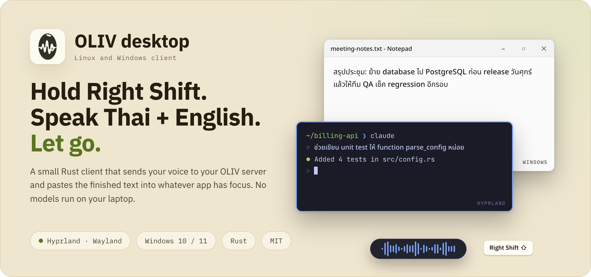
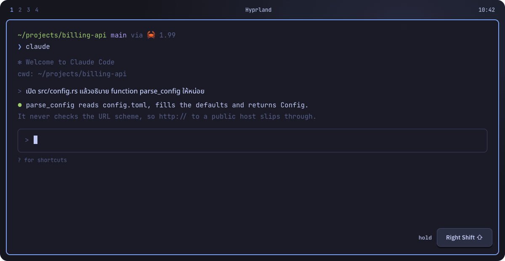

<div align="center">

<picture>
  <source media="(prefers-color-scheme: dark)" srcset="../docs/img/readme/desktop-hero-dark.png">
  
</picture>

# OLIV desktop client (Linux and Windows)

**Hold Right Shift, speak Thai mixed with English, let go.**<br>
The cleaned text is pasted into the focused app on Linux (Hyprland/Wayland) and Windows 10/11.

[](https://github.com/chayapats/oliv/actions/workflows/desktop.yml) [](src) [](#install-on-linux) [](#install-on-windows) [](../LICENSE)

[Install on Linux](#install-on-linux) · [Install on Windows](#install-on-windows) · [Run your own server](../server/README.md) · [Mac app](../README.md)

</div>

<br>

<p align="center">
  
</p>

This is a small native Rust client. It records audio, sends it to an OLIV server
(`oliv-api`: speech-to-text plus cleanup, see [`../server/`](../server/)) and pastes
the reply. It does **not** run any model locally. You point it at **your own
self-hosted OLIV server** (or one whose operator gave you a key). The macOS app in
[`../macos/`](../macos/) is separate and runs fully on-device.

## Highlights

- ⌨️ **Push-to-talk anywhere.** Hold Right Shift to record, release to dictate. Left Shift keeps working normally.
- 💬 **Shows what it's doing.** A small pill at the bottom of the screen shows a live waveform while you speak and กำลังแปลง… while the server works.
- 🪶 **Nothing heavy on your laptop.** No models, no GPU: speech-to-text and cleanup run on your OLIV server.
- 🔒 **Strict about where audio goes.** HTTPS with certificate checks, plain HTTP only on loopback and private networks, and redirects are always refused.
- 🔁 **Never loses a recording.** A failed request keeps the WAV in `pending/`; `oliv retry` sends it again when the server is back.
- 🧩 **Your words, your format.** Per-client vocabulary, ordered replacements, filler removal and Thai number formatting in `config.toml`.

## Platforms

| | Linux | Windows |
|---|---|---|
| Desktop | Wayland + wlr layer-shell, Hyprland | Windows 10/11 x64 |
| Audio | PipeWire | WASAPI default input (via CPAL) |
| Hotkey | Hyprland binds calling `oliv start/stop/cancel` | Low-level keyboard hook (physical Right Shift) |
| Paste | `wl-copy` + `hyprctl` (Ctrl+V, Shift+Insert in terminals) | Unicode clipboard + `SendInput` (Ctrl+V, Shift+Insert in consoles) |
| Daemon IPC | Unix socket `$XDG_RUNTIME_DIR/oliv.sock` | Named pipe `\\.\pipe\oliv-<user SID>` (user/SYSTEM only) |
| Autostart | systemd user unit `oliv.service` | `HKCU\...\Run\OlivWindows` (hidden PowerShell launcher) |

## Server and key

You need:

- The base URL of an OLIV server, e.g. `https://oliv.example.com`. Do not add `/v1/dictate`.
- An individual API key with scope `dictate` for this person/device, from the server operator.

The client sends audio only to that URL, over HTTPS with certificate and hostname
verification (rustls + WebPKI roots). Plain `http://` is accepted only for loopback,
RFC1918 LAN and CGNAT (`100.64.0.0/10`) addresses, for self-hosting on a private
network. Redirects are always rejected, so a key or recording never follows a `Location`.

## Install on Linux

Requires Rust/Cargo, a C toolchain with clang/libclang and pkg-config, PipeWire/SPA,
Wayland and xkbcommon development libraries, Hyprland, `wl-clipboard`, `notify-send`
and the Noto Sans / Noto Sans Thai fonts.

- Arch: `base-devel clang pkgconf pipewire libpipewire wayland libxkbcommon wl-clipboard libnotify noto-fonts noto-fonts-extra`
- Debian/Ubuntu (build deps): `build-essential pkg-config libclang-dev libpipewire-0.3-dev libwayland-dev libxkbcommon-dev`

Create a **new** private config (this never overwrites an existing one):

```sh
install -d -m 700 "${XDG_CONFIG_HOME:-$HOME/.config}/oliv"
(umask 077; set -C; cat desktop/config.example.toml > "${XDG_CONFIG_HOME:-$HOME/.config}/oliv/config.toml")
```

Edit it with your editor (never paste the key into a shell command or commit it):

```toml
[server]
url = "https://oliv.example.com"   # your OLIV server
token = "PUT-YOUR-INDIVIDUAL-KEY-HERE"
timeout_seconds = 120
```

Then install and check:

```sh
chmod 600 "${XDG_CONFIG_HOME:-$HOME/.config}/oliv/config.toml"
desktop/deploy/install-client.sh
oliv health
oliv status
```

`install-client.sh` builds the client, installs `~/.local/bin/oliv`, enables and
restarts the `oliv.service` user unit, and adds the Right Shift (record) and
Shift+Esc (cancel) binds to `~/.config/hypr/bindings.lua` once, after backing it up.
It never touches your config, history or saved recordings. If you have no
`bindings.lua`, add the equivalent binds yourself:

```lua
hl.bind('Shift_R', hl.dsp.exec_cmd('~/.local/bin/oliv start'))
hl.bind('SHIFT + Shift_R', hl.dsp.exec_cmd('~/.local/bin/oliv stop'), { release = true })
hl.bind('SHIFT + Escape', hl.dsp.exec_cmd('~/.local/bin/oliv cancel'))
```

Logs: `journalctl --user -u oliv.service -n 50 --no-pager`.

## Install on Windows

Get `oliv.exe` either from a `desktop` CI artifact (ZIP with `oliv.exe`, example
config, installer, uninstaller, `WINDOWS.md` and `BUILD.txt`; check its SHA-256) or
by building it (Rust MSVC toolchain + Visual Studio C++ Build Tools):

```powershell
$env:RUSTFLAGS = '-C target-feature=+crt-static'
cargo build --locked --release --target x86_64-pc-windows-msvc --manifest-path desktop/Cargo.toml
```

Install for the current user (no admin rights, no PATH change):

```powershell
# From an extracted ZIP:
powershell -NoProfile -ExecutionPolicy Bypass -File .\install-client.ps1
# From a source checkout:
powershell -NoProfile -ExecutionPolicy Bypass -File .\desktop\deploy\install-client.ps1
```

On first install the daemon is not started, so you can fill in the config first:

```powershell
notepad "$env:APPDATA\oliv\config.toml"   # set server.url and server.token
powershell -NoProfile -ExecutionPolicy Bypass -File "$env:LOCALAPPDATA\Programs\Oliv\start-oliv.ps1"
& "$env:LOCALAPPDATA\Programs\Oliv\oliv.exe" status --json
```

Hold Right Shift to record, release to dictate, press Escape while holding to cancel.
Left Shift keeps working normally. OLIV starts hidden at the next sign-in. Allow
desktop apps to use the microphone in Windows privacy settings.

Installer switches: `-NoStart`, `-NoAutoStart` (leave the startup entry unchanged),
`-InstallDir <path>`, `-BinaryPath <oliv.exe>`. Re-installing keeps config, key,
history and pending recordings, and stops only the process whose executable path
matches this installation. Uninstall (keeps user data unless `-RemoveUserData`):

```powershell
powershell -NoProfile -ExecutionPolicy Bypass -File "$env:LOCALAPPDATA\Programs\Oliv\uninstall-client.ps1"
```

More detail, including the desktop acceptance checklist: [docs/WINDOWS.md](docs/WINDOWS.md).

## Files

| Data | Linux | Windows |
|---|---|---|
| Config + key | `${XDG_CONFIG_HOME:-~/.config}/oliv/config.toml` (must be mode 600) | `%APPDATA%\oliv\config.toml` (user/SYSTEM-only ACL) |
| History, pending WAVs, cooldown | `${XDG_STATE_HOME:-~/.local/state}/oliv/` | `%LOCALAPPDATA%\oliv\` |
| Daemon logs | user journal | `%LOCALAPPDATA%\oliv\daemon.stdout.log`, `daemon.stderr.log` |

The daemon re-reads the config for every dictation, so key or vocabulary edits apply
immediately. See [config.example.toml](config.example.toml) for `[dictate]` options
(`cleanup`, `remove_fillers`, `thai_format`, `vocabulary`) and ordered `[replacements]`.
Pending recordings are your real voice: never upload the state directory with a bug report.

## Use

```text
oliv status [--json]        daemon state and pending count (local only)
oliv health                 unauthenticated server liveness; does not check models or key
oliv last                   print the last dictated text
oliv retry                  resend recordings kept in pending/, print their text
oliv history [N] [--json]   recent dictations
oliv start | stop | cancel  control a recording (Linux binds use these)
oliv daemon                 run the daemon in the foreground (stop the installed one first)
```

- A failed dictation (network, timeout, non-200, malformed reply) keeps the WAV in
  `pending/` and shows a notice. Nothing is resent automatically.
- `oliv retry` sends pending files oldest first, one at a time, stops at the first
  failure, prints text and records history without pasting. If exactly one text was
  recovered it is copied to the clipboard.
- `429` (and `5xx` with `Retry-After`) starts a cooldown that honours `Retry-After`
  (seconds or HTTP date, default 60 s). It is stored in the state directory and shared
  by the daemon and the CLI across restarts; new recordings during it go to `pending/`.
- Every request identifies itself as `oliv-linux/<version>` or `oliv-windows/<version>`.

Error messages and troubleshooting: [docs/API-MIGRATION.md](docs/API-MIGRATION.md).

## Develop

```sh
cd desktop
cargo fmt --all -- --check
cargo clippy --locked --all-targets -- -D warnings
cargo test --locked --all-targets
```

On Windows also run the native desktop tests in a disposable session (they inject
keys and use the clipboard): `cargo test --locked native_ -- --ignored --test-threads=1`.
CI: [`.github/workflows/desktop.yml`](../.github/workflows/desktop.yml). Code map, locks
and the test matrix: [docs/DEVELOPMENT.md](docs/DEVELOPMENT.md).
