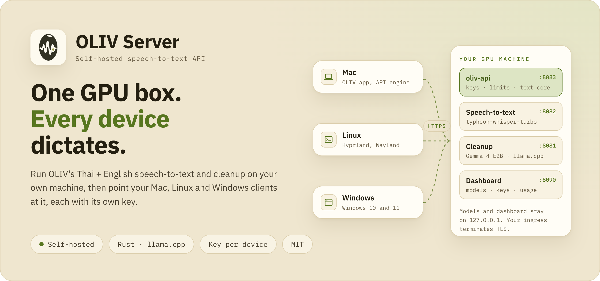
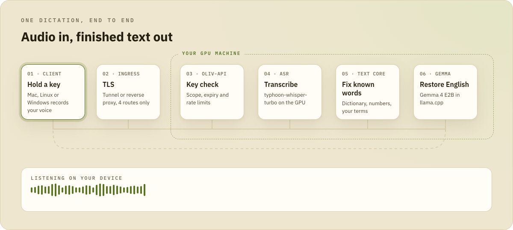

<div align="center">

<picture>
  <source media="(prefers-color-scheme: dark)" srcset="../docs/img/readme/server-hero-dark.png">
  
</picture>

# OLIV Server

**Run OLIV's Thai + English speech-to-text and cleanup on your own GPU machine.**<br>
One small HTTPS API for the Mac, Linux and Windows clients, with a separate key for each device.

[](https://github.com/chayapats/oliv/actions/workflows/server.yml) [](oliv-api) [](#requirements) [](../LICENSE)

[API contract](docs/PUBLIC-API.md) · [Dictionary sync](docs/DICTIONARY.md) · [Dashboard](docs/DASHBOARD.md) · [Linux and Windows client](../desktop/README.md) · [Mac app](../README.md)

</div>

<br>

The OLIV server runs speech-to-text and the Thai/English cleanup once, on a GPU
box you control, instead of on every laptop or phone. Point the OLIV clients
(Mac, Linux, Windows, iPhone) at it, each with its own API key.

This is a small, opinionated deployment, not a turnkey appliance. You provide
the GPU machine, the model files and the llama.cpp / faster-whisper runtimes,
and you decide how the API is reached from outside.

## Highlights

- 🖥️ **One server, every device.** The Mac app's OLIV API engine and the Linux and Windows clients all speak the same [HTTP contract](docs/PUBLIC-API.md).
- 🇹🇭 **The same text as the Mac.** The deterministic text core (Thai segmentation, built-in dictionary, Thai numbers, sound-alike matching) is the same `oliv-text-core` crate the Mac app runs.
- 🔑 **A key per device.** Each key has its own scopes, expiry and rate limits and can be revoked without a restart. Only SHA-256 hashes are stored.
- 📖 **A Dictionary that follows you.** Your personal names and terms sync across devices ([docs/DICTIONARY.md](docs/DICTIONARY.md)).
- 🔒 **Locked to loopback.** Models and the dashboard bind 127.0.0.1. The API binds loopback or one private overlay address, and you choose the TLS ingress.
- 🗂️ **No transcripts on disk.** Audio and text stay in memory. The usage log records key, route, status and timings only.
- ♻️ **Reproducible builds.** A pinned Docker image produces the same bytes for the same commit, so a deployed binary can be matched to its commit.

## How it fits together

<picture>
  <source media="(prefers-color-scheme: dark)" srcset="../docs/img/readme/server-flow-dark.gif">
  
</picture>

<details>
<summary><b>Processes and ports</b></summary>

```
client ──HTTPS──> your ingress (Cloudflare Tunnel, reverse proxy, ...)
                       │
                       ▼
               oliv-api 127.0.0.1:8083   (Rust; auth, admission, the text pipeline)
                 │                 │
                 ▼                 ▼
   ASR 127.0.0.1:8082        Gemma 127.0.0.1:8081
   whisper_server.py         llama.cpp llama-server
   (faster-whisper, or       (Gemma 4 E2B instruct GGUF)
    qwen_asr.py, optional)

dashboard.py 127.0.0.1:8090   operator panel: model settings, API keys, usage
trial_keys.py 127.0.0.1:8091  optional free-trial sign-up page
```

</details>

Every listener is bound to loopback. `oliv-api` refuses any bind other than
`127.0.0.1` or a single private overlay address (100.64.0.0/10, the range used
by Tailscale/Headscale-style networks), and the model and dashboard binds are
locked to loopback in `vm/oliv_config.py`.

## Layout

```
oliv-api/   Rust crate: lib `oliv_pipeline`, bins `oliv-api` (HTTP server) and `oliv-keys` (API keys)
vm/         everything that lives in ~/oliv on the server: start.sh/stop.sh, systemd/ user units,
            config.toml, whisper_server.py, qwen_asr.py, dashboard, consumer_tunnel.py, tests
deploy/     deploy.sh: build, then push binaries + vm/ to the server with backup and health checks
scripts/    build-release.sh: reproducible static build in a pinned Docker image
eval/       eval scoring helpers (bring your own clips and results; see eval/README.md)
docs/       API contract, dictionary, dashboard
```

The deterministic text core (Thai segmentation, built-in dictionary, Thai
numbers, phonetic matching, user dictionary) is the `oliv-text-core` crate in
[`../rust/crates/oliv-text-core`](../rust/crates/oliv-text-core), shared with
the Mac app's local engine, so the server and the Mac produce the same text.
The server is not a member of the `rust/` Cargo workspace and keeps its own
`Cargo.lock`.

## Requirements

What the shipped scripts assume. Adjusting them is possible, but this is what
is tested:

- **Linux x86_64 with an NVIDIA GPU and CUDA.** Tested on a 6 GB NVIDIA
  card (GTX 1660 class) running Gemma 4 E2B (Q4_K_M) and typhoon-whisper-turbo
  side by side; the VRAM estimates in the dashboard are measured on that card. The
  server code is Linux-only (pidfd, `/proc`, systemd user units).
- **systemd user services** (`systemctl --user`) and `loginctl enable-linger`
  for the account if the services should run without a login session.
- **Python 3.12** for the system scripts (`python3`: dashboard, config, health
  checks; 3.11+ works for those) and a venv at `~/oliv/.venv` with
  `faster-whisper` and its CUDA libraries. `start.sh` adds
  `.venv/lib/python3.12/site-packages/nvidia/{cublas,cuda_runtime,cuda_nvrtc}/lib`
  to `LD_LIBRARY_PATH`, so the pip-provided NVIDIA wheels work if you do not
  have a system CUDA install.
- **llama.cpp `llama-server`** at `~/oliv/bin/llama-b11223/llama-server`
  (the path is fixed in `vm/start.sh`; build b11223 is what is tested).
- **Models** under `~/oliv/models/` (paths in `vm/config.toml` must stay under
  `models/`):
  - Gemma: `models/gemma/gemma-4-E2B-it-Q4_K_M.gguf`, a GGUF of Gemma 4 E2B
    instruct. It runs the cleanup pass.
  - ASR: `models/whisper/typhoon-turbo-int8-float16/`, a CTranslate2 conversion
    of typhoon-whisper-turbo (the directory must contain `model.bin`), for
    example `ct2-transformers-converter --model typhoon-ai/typhoon-whisper-turbo
    --quantization int8_float16 --output_dir models/whisper/typhoon-turbo-int8-float16`.
  - Optional: `asr_profile = "qwen3asr"` runs a Qwen3-ASR GGUF in llama-server
    through `vm/qwen_asr.py` instead. No Qwen3-ASR weights are distributed with
    OLIV; see `vm/qwen-profile.example.json` for the pinned profile it needs.
- **Docker** on the build machine for `scripts/build-release.sh`.
- Optional: **cloudflared** at `~/oliv/bin/cloudflared` if you publish the API
  through a Cloudflare Tunnel with the bundled `api-tunnel` helper.

## Build

From the monorepo root:

```sh
server/scripts/build-release.sh          # static musl oliv-api + oliv-keys, prints sha256
server/scripts/build-release.sh --test   # run the whole test suite in the same image first
```

The build runs in `rust:1.99.0-alpine` pinned by digest, with the monorepo
mounted at `/work`, so the same commit always produces the same bytes and a
deployed binary can be matched to its commit by sha256. Do not add `--target`;
it changes the output bytes. Output: `server/oliv-api/target/release/`.

## Test

```sh
cargo test --locked --manifest-path server/oliv-api/Cargo.toml --all-targets   # Linux
python3 -m unittest discover -s server/vm -p 'test_*.py'                     # Linux
```

The Rust suite includes the offline golden tests: public fixtures with mocked
LLM replies, described in
[`oliv-api/tests/golden/README.md`](oliv-api/tests/golden/README.md).
Both suites are Linux-only (the Rust crate uses Linux `libc` signatures, the
Python tests use pidfd and `/proc`); on macOS run them through
`build-release.sh --test` or a Linux container. The dashboard key/usage tests
skip unless `oliv-api/target/*/oliv-keys` is built (they fail instead when
`CI` is set). CI: [`.github/workflows/server.yml`](../.github/workflows/server.yml).

## Install on the server

The server side is a single directory, `~/oliv`, holding the contents of `vm/`
plus your binaries, models and private state. As the user that will run OLIV:

```sh
mkdir -p ~/oliv/bin ~/oliv/models && chmod 700 ~/oliv
# copy vm/ into ~/oliv (deploy/deploy.sh does this for later updates)
# put llama-server in ~/oliv/bin/llama-b11223/, the models in ~/oliv/models/,
# and create ~/oliv/.venv with faster-whisper
cp server/oliv-api/target/release/oliv-api server/oliv-api/target/release/oliv-keys ~/oliv/bin/
```

Then:

1. **Configure** `~/oliv/config.toml` (start from `vm/config.toml`). The
   `[gemma]` and `[whisper]` sections are the model runtime settings; `[api]`
   selects the cleanup prompt, LLM timeout and ASR profile. Binds and ports are
   fixed: Gemma 8081, ASR 8082, API 8083, dashboard 8090. `python3
   ~/oliv/oliv_config.py check` validates the file, and `estimate` prints the
   VRAM estimate.
2. **Create the key store and a first key** (see [API keys](#api-keys)).
3. **Install the services**:
   ```sh
   mkdir -p ~/.config/systemd/user
   cp ~/oliv/systemd/*.service ~/oliv/systemd/*.timer ~/.config/systemd/user/
   systemctl --user daemon-reload
   systemctl --user enable --now oliv-gemma oliv-whisper oliv-api oliv-dashboard oliv-health.timer
   ```
   The units use `%h/oliv`, so they work for any account whose home holds
   `~/oliv`. Once installed, `~/oliv/start.sh` and `~/oliv/stop.sh`
   (`gemma|whisper|api|api-tunnel|all`) route through systemd; `all` never
   includes the tunnel. `oliv-health.timer` restarts a service that is active
   but no longer answers its health check.
4. **Check** `curl -s http://127.0.0.1:8083/health` (`{"ok":true}`), then send
   a real request with a key as shown in [docs/PUBLIC-API.md](docs/PUBLIC-API.md).

## Reaching the API from your devices

`oliv-api` speaks plain HTTP on loopback; TLS has to terminate in front of it.
Pick one:

- **Cloudflare Tunnel (bundled helper).** `~/oliv/start.sh api-tunnel` runs
  `cloudflared` with `~/oliv/cloudflared/consumer-config.json`, which you
  provision by hand (mode 600) together with its credentials file and the DNS
  route for your hostname:
  ```json
  {"tunnel": "<tunnel UUID>",
   "credentials-file": "<absolute path of ~/oliv>/cloudflared/consumer-credentials.json",
   "ingress": [{"hostname": "oliv.example.com", "path": "^/(health|v1/(dictate|clean|dictionary))$",
                "service": "http://127.0.0.1:8083"},
               {"service": "http_status:404"}]}
  ```
  `vm/consumer_tunnel.py` refuses to start unless the file has exactly these
  three fields, `credentials-file` is that absolute path, the ingress is exactly
  that shape (only the hostname is yours), the API is in keys mode on loopback
  and the key store validates. Enable `oliv-api-tunnel.service` to keep it running.
- **Your own reverse proxy** (Caddy, nginx, ...) on the same machine, proxying
  only `/health`, `/v1/dictate`, `/v1/clean` and `/v1/dictionary` to
  `127.0.0.1:8083`. The origin rejects requests whose `X-Forwarded-Proto` is
  anything other than a single `https`.
- **A private overlay network only.** Set `[api] host` to the machine's
  100.64.0.0/10 overlay address (Tailscale, Headscale). Clients accept plain
  HTTP only for loopback, RFC 1918 and 100.64.0.0/10 addresses.

Whichever you choose, keep `/v1/status`, the model ports and the dashboard off
the public ingress.

Then point each client at your server: in the Mac app, Settings ▸ Cloud
services ▸ Enable OLIV API, with your server URL and that device's key; in the
Windows and Linux clients, `[server] url` and `token` in their `config.toml`
(see [docs/PUBLIC-API.md](docs/PUBLIC-API.md)).

## Free trial

Off by default. It lets people try OLIV without you issuing each key: the
iPhone app's **Start free trial** button and the page at `/try` both call
`vm/trial_keys.py`, which creates a short, low-limit key through `oliv-keys`.

1. Create `~/oliv/trial.json`. Only the fields you want to change are needed:

   ```json
   {"testflight_url": "https://testflight.apple.com/join/YOUR_CODE",
    "expires_in_days": 7, "requests_per_minute": 6, "daily_requests": 60,
    "keys_per_client_per_day": 2, "keys_per_day": 30, "max_active": 100}
   ```

2. Install and start the service:

   ```sh
   cp ~/oliv/systemd/oliv-trial.service ~/.config/systemd/user/
   systemctl --user daemon-reload
   systemctl --user enable --now oliv-trial
   ```

3. Add the route to `~/oliv/cloudflared/consumer-config.json`, directly after the
   API rule, then restart the tunnel with `stop.sh api-tunnel` and
   `start.sh api-tunnel`:

   ```json
   {"hostname": "oliv.example.com", "path": "^/try(/key|/health|/)?$",
    "service": "http://127.0.0.1:8091"}
   ```

Set `"enabled": false` in `trial.json` to close sign-ups immediately; no restart
is needed, and missing or invalid settings also close them. Existing trial keys
keep working until they expire, or until you revoke them. The limits are what
bound GPU use: at the defaults, at most 30 new keys a day, 100 active trial keys
and 60 requests a day per key. Trial keys are marked as such in the key store, stop working after
`expires_in_days`, and are deleted 30 days later; no other key is ever deleted. The daily counters in
`trial-ledger.json` hold keyed hashes, not addresses.

## API keys

Clients authenticate with individual bearer keys. `oliv-keys` is the only
authority over the key store (`~/oliv/api-keys.json`, which holds SHA-256
hashes and metadata, never raw keys):

```sh
~/oliv/bin/oliv-keys --root ~/oliv init
~/oliv/bin/oliv-keys --root ~/oliv create --name my-mac --out ~/my-mac.key \
    --expires-in-days 90 --scopes dictate --requests-per-minute 10 --daily-requests 500
~/oliv/bin/oliv-keys --root ~/oliv list
~/oliv/bin/oliv-keys --root ~/oliv revoke KEY_ID_FROM_LIST
~/oliv/bin/oliv-keys --root ~/oliv profile link <phone-key-id> <mac-key-id>   # share one dictionary
```

`create` writes the raw key only to the `--out` file (mode 600), never to
stdout; hand it to the device owner over a private channel. Scopes are
`dictate` (dictation and the personal dictionary), `clean` (text-only cleanup)
and `status` (backend details; keep it off public ingress). The API re-reads
the store on every request, so no restart is needed after create or revoke.
Details and limits: [docs/PUBLIC-API.md](docs/PUBLIC-API.md).

The dashboard can create, list and revoke keys too ([docs/DASHBOARD.md](docs/DASHBOARD.md)).
It has **no login of its own**: it binds 127.0.0.1:8090 and anyone who can
reach that port can manage keys and restart models. Reach it with
`ssh -L 8090:127.0.0.1:8090 <server>` and open http://127.0.0.1:8090, or put it
behind an authenticating proxy such as Cloudflare Access; never expose it
directly.

## Updating a server

`deploy/deploy.sh` builds with `build-release.sh`, compares file hashes with the
server over SSH, backs up whatever it will overwrite to
`~/oliv/backups/deploy-<timestamp>.tgz`, syncs the changed files, validates the
config and key store with the staged binaries, swaps them in and restarts
`oliv-api` only when it has no open connections:

```sh
OLIV_VM=user@gpu-box server/deploy/deploy.sh --dry-run   # show what would change
OLIV_VM=user@gpu-box server/deploy/deploy.sh
```

`OLIV_VM` (an ssh destination or `~/.ssh/config` alias) is required. It needs
bash 4 and GNU rsync; on macOS use `deploy/deploy-in-container.sh` with the
same arguments. It never touches `config.toml`, keys, tokens, tunnel
configuration or `qwen-profile.json`, never restarts Gemma, and never deletes
anything on the server.

## Data and privacy

Audio and transcripts pass through the server's memory only; `oliv-api` does
not store them. The usage history (`~/oliv/usage/requests.sqlite3`) records
key ID, route, status and timings, never audio, text, tokens or IP addresses.
The personal dictionary is stored per profile in
`~/oliv/dictionary/dictionary.sqlite3`. If you publish through a third-party
tunnel or proxy, that provider is on the path of your users' audio.

## Language of the docs

`docs/PUBLIC-API.md`, `docs/DASHBOARD.md` and this README are in English.
`docs/DICTIONARY.md`, `oliv-api/KNOWN_DIFFS.md`, some code comments and the
dashboard UI are in Thai.
